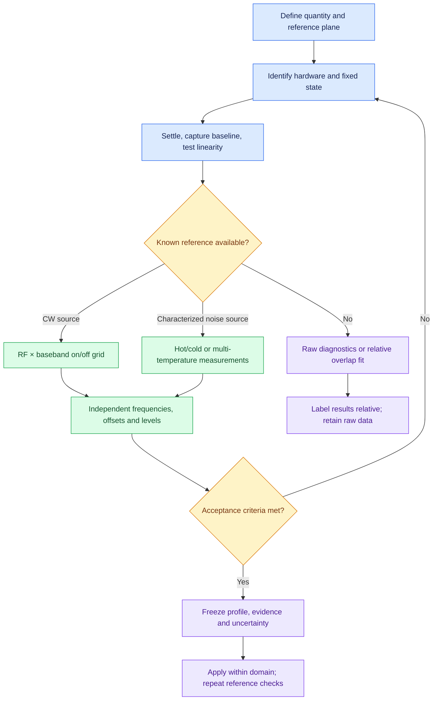

# Calibration: complete measurement procedure

Start here for the order of operations. Use the [device guide](SDR_DEVICE_GUIDE.md)
for the controls and architecture of your receiver, [calibration reference](CALIBRATION.md)
for manifest fields, and [radio theory](RADIO_THEORY.md) for estimator definitions.
Calibration is specific to a unit, signal path and configuration. Passing software
validation establishes consistency of the supplied evidence; it does not certify
an RF source, receiver linearity, impedance or measurement uncertainty.

## 1. Decide what you need to measure

| Goal | Minimum useful evidence | Result and boundary |
| --- | --- | --- |
| Check noise, DC, spurs and repeatability | Matched termination; repeated fixed-state captures | Raw baseline, not gain or noise figure |
| Measure input power | Known CW source, measured path loss, on/off captures | Absolute scale over the measured RF/baseband domain |
| Measure receiver noise figure and gain | Characterized hot/cold source and temperature/path data | Y-factor estimate, conditional on match, linearity and stationarity |
| Characterize an external LNA | Receiver-only and cascade measurements at the same downstream configuration | Gain/noise separation with fixture losses and uncertainty |
| Flatten a displayed spectrum | Measured response or validated passive overlap observations | Optional relative PSD shaping; no improvement in SNR |
| Check oscillator drift | Isolated, operator-selected IQ tone and suitable reference | Apparent frequency/drift diagnostic, not automatic frequency correction |

Do not use broadcast signal strength as a known absolute input power. Propagation,
antennas, fading and transmitter behavior are unknown. Quiet intervals are not
matched thermal loads. See [passive references](PASSIVE_REFERENCES.md).



## 2. Define the reference plane and connections

Draw the actual chain, for example `source → cable → pad → SDR input`, or
`termination → LNA → cable → SDR`. Name the connector where input power or
noise temperature is defined. A termination before the LNA characterizes the
whole chain; one after it characterizes the downstream receiver only.

Use the impedance specified for that port. A high-impedance ADC input, a 75 Ω
television input and a 50 Ω RF input are different measurement systems. Record
adapters, splitters, DC blocks, filters and attenuators, including their measured
loss versus frequency, temperature and match. For LNA isolation, keep downstream
pads and receiver settings unchanged between through and cascade observations.

Verify bias power is off before attaching a passive load. Confirm the actual
port and firmware behavior; a software default alone is insufficient. Use a
suitable DC block when needed and include its loss. Choose source levels from
the receiver's published electrical limits and a measured linear operating range.
A damage limit is not a recommended calibration level.

## 3. Inventory the exact unit and software

```sh
soapy_power --detect
soapy_power -d 'driver=REPLACE,serial=REPLACE' --info > device-info.txt 2>&1
```

Replace discovery arguments with the actual device. Archive model, serial,
board/daughterboard revision, channel, port, driver, firmware/FPGA and library
versions. Select the RX channel with `-C` and advertised antenna with `-A`.
Read the [family-specific checklist](SDR_DEVICE_GUIDE.md) before choosing gains,
clock sources, filters or native correction modes.

Record actual accepted sample rate and bandwidth, every gain stage, AGC modes,
RF path, clock/time sources, correction state, converter LO and sideband, and
all external chain components. `--info` is a capability inventory; acquisition
metadata records the settings actually used. Unsupported readbacks can prevent
a defensible fixed-state calibration even when raw acquisition works.

## 4. Establish a reproducible frontend state

Warm the receiver and source until repeated reference readings meet your drift
budget; determine this experimentally rather than assuming a universal duration.
Use fixed gain with `-g` or advertised stages with `-G`. Disable all relevant RF,
IF and digital AGC, including independent device settings where exposed. A
nominal gain slider does not prove gain stayed constant.

Complete manufacturer-recommended native frontend calibration with this program
disconnected. Native DC/IQ/LO correction improves spectral fidelity but does not
establish input dBm. Do not copy correction commands between different RFICs.
Keep automatic correction at a deliberate, recorded state. Manual coefficients
are driver-normalized controls, not dB or radians; see [bladeRF](BLADERF.md) and
[Ettus](ETTUS.md). A change in these settings requires new reference verification.

Use `--clock-source`, `--time-source` and `--master-clock-rate` only when supported.
An external reference must have the correct frequency, level and connection for
that unit. Request advertised lock sensors where available. Shared reference
clocking does not by itself establish channel phase alignment or UTC timing.

## 5. Choose acquisition and settling parameters

Use linear JSON, complete acquisitions, fixed tuning per file, and unchanged
processing for every reference pair. The following is a **geometry example**;
replace driver/gain with supported values and establish a safe source level first:

```sh
soapy_power -d 'driver=REPLACE,serial=REPLACE' -f 100.1M -r 2M \
  -b 4096 -g 20 -n 128 -u 4 --tune-delay 0.1 --settle-samples 32768 \
  --partial-policy reject -l -F json -O tone-100M-minus100k-on.jsonl
```

At this tune a 100 MHz source lies at raw IQ offset −100 kHz in an ordinary
noninverted path. Capture source-off into a different filename using exactly the
same settings after changing the physical source state and allowing it to settle.
The example delay and discard count are starting values, not measured settling
guarantees. Confirm stability after every tune, gain or source change.

`-n 128` means 128 FFT-sized sample blocks, not 128 samples or 128 independent
averages. With N=4096 it requests 524288 samples per acquisition; overlapping
Welch frames are correlated. `-u 4` repeats measurements. Use the reported
complete-segment counts; the default 32-segment gate is not a confidence interval.

Avoid detrending and DC interpolation in reference captures. Put reference tones
away from DC, edges, images and spurs. `--dc-mask-width` excludes measured bins;
`--dc-offset` uses raw IQ coordinates. A mask cannot reconstruct lost energy.
External LO/high-side/conjugated paths require their actual frequency mapping.
Use actual accepted rate, not a requested rate that the driver rounded.

Inspect partial data, overflow, discontinuities and context changes. Use
`--require-timestamps` only when verified hardware timestamp continuity exists;
many USB receivers cannot satisfy it. Lack of a timestamp flag is not evidence
of continuous capture. Investigate integrity failures before building a profile.

## 6. Record a terminated baseline

Connect the specified termination at the reference plane, record its temperature
in kelvin and repeat a capture with a unique output name. Analyze a clean band
away from DC; for a 100 MHz tune at 2 MS/s, an example is:

```sh
soapy_power_calibration baseline terminated.jsonl \
  --temperature-k 293.15 --source-ohms 50 --receiver-ohms 50 \
  --start-hz 100100000 --stop-hz 100200000
soapy_power_calibration compare terminated.jsonl antenna.jsonl \
  --start-hz 100100000 --stop-hz 100200000
```

Use measured temperature and actual port impedances. Capture `antenna.jsonl`
separately with identical settings. Examine multiple bands, tunes and repetitions.
Antenna excess includes external noise, signals, mismatch and receiver noise
changes. Negative noise-subtracted observations remain negative evidence.

The ideal 75 Ω to 50 Ω mismatch loss is about 0.1773 dB, not a universal dongle
correction. A single load gives `D = Gdigital k (Tsource + Te)` and cannot
separately identify gain and receiver noise temperature. See [termination details](CALIBRATION.md).

For [IQ noise diagnostics](NOISE_CALIBRATION_AUDIT.md), acquire correctly scaled
complex `.npy` IQ externally: the spectrum capture command above produces JSON
spectra, not an IQ recording. Preserve IQ sample rate, normalization and state.

## 7. Verify linearity before collecting a full grid

Use several known source levels at a fixed RF/offset and unchanged gain, retaining
an off measurement. Check whether noise-subtracted linear power follows the
known input ratios within the predeclared uncertainty. Repeat at representative
frequencies and at the hottest intended noise-source state. Inspect harmonics,
images, intermodulation and amplitude distributions where IQ is available.

Low digital amplitude does not exclude compression in an LNA, mixer or analog
filter. Reduce gain or input power and repeat when response bends. A higher gain
setting can change the entire gain distribution and noise figure. Characterize
it as a separate state; never assume its nominal dB difference is exact.
[Gain comparison](PASSIVE_REFERENCES.md) is diagnostic; a stable broadcast source
can still fade between observations.

## 8. Measure an absolute CW grid

Copy [tone.json](examples/calibration/tone.json) and create its capture directory.
Keep its source powers null until measured values are available. In an ordinary
noninverted receiver without an external converter, `tune = RF − baseband`:

| RF (MHz) | Raw baseband (kHz) | Tune (MHz) | Required evidence |
| --- | --- | --- | --- |
| 100 | −100 | 100.1 | On/off at identical state |
| 100 | +100 | 99.9 | On/off at identical state |
| 101 | −100 | 101.1 | On/off at identical state |
| 101 | +100 | 100.9 | On/off at identical state |

This small rectangular grid demonstrates the manifest geometry. Expand RF and
baseband coverage to include **every retained measurement bin**, including the
reference offset. These four cells do not calibrate a whole 2 MHz passband.
Measure additional points around filter transitions; do not interpolate across
hardware path switches or deep notches as though they were smooth response.

For each cell, set the source's RF, tune the receiver, settle, capture on/off,
and fill the integration band `[start_hz, stop_hz)` around that same RF tone.
Choose a band containing tone leakage/drift but excluding unrelated signals and
masked bins. A single-bin peak is not integrated tone power. The off connection
must preserve source impedance; simply disabling a generator may change its
output match. Record the switching method and check its effect.

In this manifest, `input_dbm` is source-plane power and `path_loss_db` is the
loss from that plane to the named receiver plane. The receiver input is their
difference. By contrast, independent holdout and characterization CW powers are
already specified at their reference plane: do not subtract cable loss twice.

```sh
soapy_power_calibration from-captures tone.json -O receiver-power.json
soapy_power_calibration validate receiver-power.json
```

The builder subtracts on/off power in linear units. Insufficient positive excess
is not repaired by logarithms or more decimal places. Improve SNR, integration
geometry or averaging while remaining linear. Preserve raw evidence and the
filled manifest alongside the generated profile.

## 9. Measure hot/cold noise and receiver noise figure

Use [hot-cold.json](examples/calibration/hot-cold.json) with a calibrated noise
source and its frequency-dependent ENR, uncertainty and cold temperature. Capture
hot/cold at identical receiver state, source position and integration geometry.
Measure path loss and its physical temperature. For matched passive loss L:

`Tplane = Tsource/L + Tpath (1 − 1/L)`.

With ENR referenced to T0=290 K, `Th = Tc + 290 × 10^(ENR_dB/10)`;
`Y = Phot/Pcold`, `Te = (Th − Y Tc)/(Y − 1)` and `F = 1 + Te/290` under the
stated model. Powers are linear averages. Y near one makes the estimate highly
sensitive to uncertainty. Higher ENR can instead overload the receiver or change
hidden gain. Validate both conditions and repeat the measurements.

Account for image/alias noise and the actual analog passband: a broadband noise
source may enter through more than the displayed RF band. Software PSD shaping
cannot fix an unmodeled image response. Negative fitted noise temperatures are
an inconsistency to investigate, not values to clip silently.

A [known-NF template](examples/calibration/known-nf.json) supplies a conditional
scale only when NF is independently characterized for that frequency, gain,
impedance and temperature. An advertised typical NF is not such evidence.

## 10. Characterize LNA gain and noise, then validate independently

Follow [receiver characterization](RECEIVER_CHARACTERIZATION.md) for receiver
and cascade multi-temperature fits, fixture losses, Friis calculations and
optional uncertainty propagation. Use at least three distinct source temperatures
per fitted configuration and the required known CW level checks. Preserve the
same downstream chain between baseline and LNA measurements. This produces a
characterization report, not a live power profile.

Reserve independent RF frequencies, baseband offsets and source levels before
fitting. Use [independent-holdouts.json](examples/calibration/independent-holdouts.json)
and [response validation](FLATTENING.md). Freeze the candidate before inspecting
holdout outcomes. Include source/path calibration, mismatch, drift, temperature,
repeatability, interpolation and bandwidth/estimator effects in the uncertainty
budget. Correlated systematic errors do not decrease as 1/√N. Monte Carlo output
is conditional on its supplied uncertainty and covariance model.

For optional flattening, use [equalization](EQUALIZATION.md) and
[constrained smoothing](FLATTENING.md). Attenuation-only shaping uses a common
whole-file target; regularization bounds correction near weak response. Neither
recovers clipped, masked or absent information. Smoothing requires independent
holdouts and does not establish phase response. Passive overlap profiles are
relative IF responses and are not accepted as absolute live calibrations.

## 11. Apply, archive and maintain

Use `--calibration receiver-power.json` with the same device/context and only
within the measured RF/baseband domain. Select rate, tune and retained bandwidth
that actually fit that domain. Inspect output units and provenance; calibrated
noise includes receiver-added noise unless a separately justified model removes
it. Do not apply a second native dBm conversion or a second application correction.

Archive raw captures/IQ, source certificates, filled manifests, context, profile,
validation results, uncertainty assumptions, connection diagram, temperatures,
software versions and a dated operator log. File-producing offline commands use
`--force` for intentional output replacement; input evidence must remain separate
from outputs even when replacement is requested.

At each session, repeat a terminated baseline and known reference checks at
representative frequencies and levels. Set a recheck interval from measured drift
and the required uncertainty. Recheck after reconnecting cables, thermal changes,
firmware/driver changes, clock/rate/bandwidth/filter/gain/AGC/correction changes,
channel or antenna changes, or modification of the external chain. Create a new
profile when the measurement configuration changes; a previous filename is not
proof the old calibration still applies.

## Troubleshooting and stop conditions

| Observation | Investigate before proceeding |
| --- | --- |
| Context mismatch or unknown gain state | Wrong unit/channel/path; hidden AGC; missing readbacks; incompatible driver |
| Tone appears mirrored or at the wrong frequency | IQ conjugation, converter sideband, tune arguments and actual LO mapping |
| DC notch or unusually flat center | Native DC tracking, detrending or interpolation; move the reference off DC |
| Gain-dependent noise shape | Gain distribution, analog compression, filters, internal noise; do not invert it as gain |
| Y≈1, negative Te or inconsistent fits | ENR/path/temperature errors, drift, match, hidden gain, overload or alias noise |
| Profile rejected outside domain | Extend measured grid or reduce the explicitly retained band; do not extrapolate |
| Drops, partial frames or nonstationarity | Transport/CPU load, driver buffering, settling and timestamp capabilities |
| Holdout fails after smoothing | Reject the candidate; retain original evidence and investigate model limitations |

For parser options use `soapy_power --help` and
`soapy_power_calibration COMMAND --help`. These procedures describe supported
workflows; actual device verification remains an RF measurement task.
