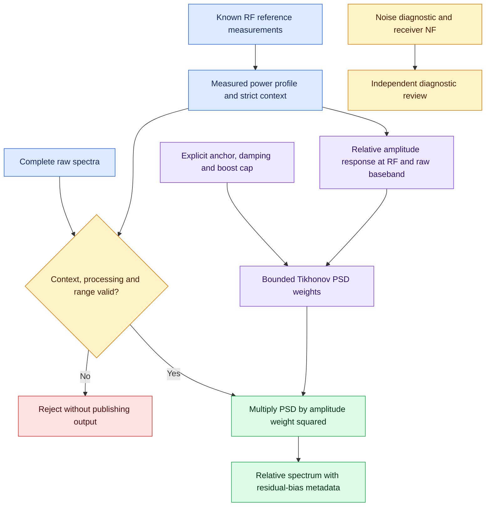

# Optional relative PSD equalization and report audit

The supplied room-correction report was reviewed as a proposal. Its useful
addition is a bounded inverse of **measured transfer response**. This release
adds an offline `equalize` command using an existing measured RF/raw-baseband
power profile. It does not invert the terminated noise diagnostic curve.

## Corrections to the supplied report

| Report statement | Correct interpretation |
| --- | --- |
| RBW = sample rate / overlap | False. Bin spacing is fs/N; window ENBW is fs*sum(w²)/abs(sum(w))². Overlap affects correlation and averages, not this bandwidth. |
| PSD formula includes bandwidth B | Density is per Hz and excludes B. Multiply by bandwidth to obtain integrated power. |
| Gain G used for both IQ and PSD | IQ uses complex amplitude H; power uses G=abs(H)². An amplitude inverse W acts on PSD as abs(W)². |
| Receiver noise temperature includes source termination and is then added to source T | This double-counts the source. Use D=Kdigital*kB*(Tsource+Te), where Te is receiver-added input-referred noise. |
| Thot = Tcold*(1+ENRlinear) at arbitrary cold temperature | Use Thot=Tcold+290*ENRlinear, subject to the source certificate's actual temperature model. |
| NF denominator is actual cold temperature | Conventional NF uses T0=290 K. The simplified ENR/Y expression requires Tcold=T0. |
| Native integer scaling establishes watts or RF volts | It establishes sample coding only. Absolute physical scale needs a measured reference. |
| Arbitrary N/Nmax is a Wiener noise/signal ratio | It is not a physically justified prior. Wiener design needs consistent input/output units and a declared signal/noise model. |
| Magnitude curve determines FIR phase | It does not. Discarding the imaginary IFFT part or retaining the first taps need not preserve the response, causality or complex-IQ asymmetry. |
| Parseval means equalization preserves input power | Parseval relates each transformed signal's energy to its own spectrum. Equalization generally changes total power. |
| A loopback must have unity gain and only thermal noise | TX/RX gain, leakage, mismatch, clocks and generated noise remain; no universal unity expectation exists. |
| B200mini RF input is approximately 1 kilohm | Ettus specifies 50-ohm RF ports. Its ADC resolution is 12 bits; do not infer RF impedance from internal converter circuitry. |

The report's reference-number placeholders do not supply traceable source
links. This implementation instead links the official sources below. Generic
claims of professional noise-meter accuracy or universal safe injected levels
are not adopted. Source levels and protective pads must suit the actual device.

## Usage

Create an actual [measured power profile](CALIBRATION.md) first, and retain raw
uncalibrated JSONL measurements. Then, for example:

```sh
soapy_power_calibration equalize raw.jsonl \
  --profile measured-power.json \
  --reference-rf-hz 915000000 --reference-baseband-hz 100000 \
  --regularization 0.001 --max-boost-db 12 \
  --output equalized.jsonl
```

Both anchor coordinates must be within the measured calibration grid. Baseband
is the **original raw IQ coordinate**, before IQ conjugation and external LNB
axis inversion. Choose a reliable, high-SNR reference point in the desired
passband. The same anchor is used for every hop; its RF/baseband combination
need not be present in each individual capture. The result is normalized to
that measured transfer response, not a new absolute dBm/Hz calibration.

`--regularization` is nonnegative dimensionless relative power, not dB or
amplitude. Zero requests direct inversion, still bounded by `--max-boost-db`.
The default 0.001 is an engineering damping choice, not a calibrated Wiener
prior. `--max-boost-db` is a nonnegative upper bound on spectral boost. There is
no arbitrary hard floor that pretends a measured null contains recovered signal.

The workflow is offline and optional. Existing acquisition/absolute calibration
behavior is unchanged. For physical input-referred power, use the existing
absolute calibration path directly rather than this relative display transform.
A regularized display correction deliberately sacrifices exact flattening.

## Mathematics

Let C(f,bb) be the measured dB offset converting raw digital power to input mW,
and Cref the offset at the chosen anchor. The relative power response is

```text
Grelative = 10**((Cref-C)/10)
Hrelative = sqrt(Grelative)
W = (1+lambda)*Hrelative/(Hrelative**2+lambda)
PSDrelative = PSDraw * abs(W)**2
```

The factor `(1+lambda)` preserves unity at the reference response H=1. For
lambda=0 the ideal power weight is `10**((C-Cref)/10)`. The upper boost cap
applies after regularization. Log-domain evaluation avoids intermediate overflow
for very weak response. Unrepresentable linear results fail explicitly; use raw
logarithmic density when necessary. Measured zeros and excluded bins retain
their classifications.

Metadata records per-bin weights in dB, the relative chain gain, uncapped
requested weights, boost-limited bins and predicted residual response
`10*log10(Grelative*abs(W)**2)`. Amplitude-weight dB uses 20*log10(abs(W));
power-weight dB uses 10*log10(abs(W)**2), so their numerical dB values agree.
Profile identity, anchor, source-record hash and explicit non-absolute status
are retained.

A deterministic equalizer multiplies signal and noise by the same power weight;
it cannot improve per-bin SNR or undo receiver-added noise, analog clipping,
compression, aliasing or an unmeasured notch. Noise-floor subtraction is a
separate statistical excess-power estimate with uncertainty and possible
negative estimates; it is not applied here. Never clamp it into fabricated
positive calibrated measurements.

## Validation and data integrity

Each hop requires complete acquisition, matching fixed-gain hardware context,
profile processing compatibility, correct frequency orientation and measured
RF/baseband coverage. There is no extrapolation. Actual tuned center, external
LO, sample rate and conjugation determine original raw coordinates. Exact
frequency-grid metadata is used when available to avoid subtracting large RF
numbers to reconstruct tiny baseband offsets.

Already calibrated or already equalized input is rejected. Estimated/DC
interpolated bins are rejected; explicit masks and measured zeros survive.
Native digital units are retained and equalization metadata marks the result
as a transformed relative spectrum. Standard record integration can integrate
that transformed density, but the value is not certified input RF power.
Reference workflows and context extraction reject equalized records so they
cannot be recycled into another calibration accidentally.

The command streams one hop at a time into a temporary JSONL file, then fsyncs
and atomically publishes only after every hop succeeds. A late input failure
publishes nothing and leaves an existing destination unchanged, even with
`--force`. Output may not replace its source records or source profile. A
source-record hash is checked again before publication. SHA-256 identifiers
provide provenance/integrity, not signatures or proof that a physical source
certificate was correct.

No new transformed uncertainty budget is inferred. Calibration uncertainties,
correlated response errors, damping choice and residual bias must be considered
for the intended analysis. A flat-looking noise trace is not evidence of a
correct transfer calibration.

## What this does not claim

No causal time-domain filter, phase correction or complex transfer measurement
is derived from these magnitude measurements. A future IQ filter requires an
explicit phase model or measured complex response, a defined reference plane,
causal delay, finite-length approximation validation and streaming state/reset
handling. A real symmetric FIR would additionally impose symmetry that is not
generally valid for an asymmetric complex receiver passband.

The existing [receiver/LNA characterization](RECEIVER_CHARACTERIZATION.md)
already provides source-temperature fits, scalar Friis separation, CW checks
and conditional correlated uncertainty. The [IQ noise audit](NOISE_CALIBRATION_AUDIT.md)
remains diagnostic. These three functions stay separate from absolute power
calibration and from any claim of physical RF certification.

## Colored flow



## Evidence and remaining measurements

Synthetic tests verify direct inversion, regularization bias, boost limiting,
signal/noise scaling, shaped-IQ recovery against the original Welch spectrum,
Parseval integration, logarithmic/linear agreement, inversion/conjugation
coordinates, strict context/range checks, masks, provenance and atomic late
failure. No physical hardware or phase-response measurement is claimed.

References:
[Welch density scaling and ENBW](https://docs.scipy.org/doc/scipy/reference/generated/scipy.signal.welch.html),
[Ettus B2xx RF impedance](https://kb.ettus.com/index.php?redirect=no&title=B200%2FB210%2FB200mini%2FB205mini%2FB206mini),
[B200mini converter specifications](https://www.ettus.com/wp-content/uploads/2019/01/USRP_B200mini_Data_Sheet.pdf).
