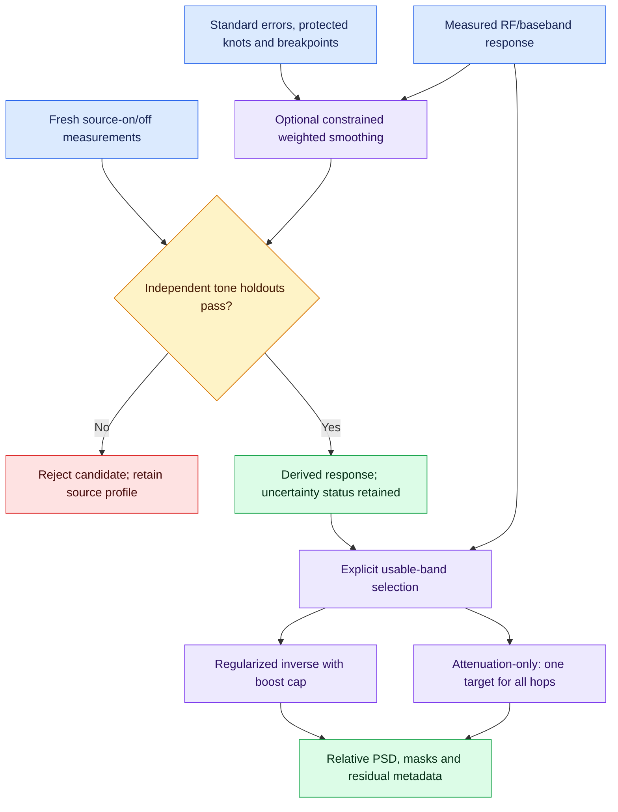

# Measured FFT response flattening

This release completes the relevant PSD workflow additions: attenuation-only
shaping, explicit usable-band selection, uncertainty-weighted baseband response
smoothing and independent measured-tone validation. They remain optional.
Absolute power calibration, relative display equalization and receiver noise
characterization retain their distinct meanings. No software test establishes
perfect RF accuracy or recovers information lost in analog hardware.

## Attenuation-only mode

```sh
soapy_power_calibration equalize raw.jsonl --profile measured-power.json \
  --reference-rf-hz 915000000 --reference-baseband-hz 100000 \
  --mode attenuation-only --output attenuated.jsonl
```

The CLI chooses zero regularization for this mode. A nonzero explicit
`--regularization` is rejected. It first scans all hops, validates their contexts
and determines the weakest retained response. A second bounded-memory pass
applies a **single target across the whole file**, preserving relative levels
between hops. The source hash must remain unchanged through both passes.

For measured input-power offsets C and global target Ct=max(C):

```text
power_weight_db = C - Ct <= 0
power_weight = 10**((C-Ct)/10)
amplitude_weight = 10**((C-Ct)/20)
```

The result is flat at the weakest retained response, rather than boosted to the
original reference level. Metadata records that target, its level relative to
the chosen anchor, and the residual relative to the target. No gain/noise
improvement is claimed. `max_boost_db` is effectively zero in this mode.
Extremely large attenuations that cannot be represented in linear output fail;
raw logarithmic input supports a larger dynamic range.

The Python single-record API can choose a per-record target and labels its scope
accordingly. Use `equalize_file()` for coherent multi-hop levels; do not stitch
independently normalized records as if their targets were identical.

## Usable-band selection

Supply `--usable-policy usable-band.json` with explicit thresholds, for example:

```json
{
  "edge_guard_hz": 100000,
  "dc_exclusion_hz": 5000,
  "dc_offset_hz": 0,
  "max_correction_db": 6,
  "max_residual_db": 0.25
}
```

See [usable-band.json](examples/calibration/usable-band.json). Values are
engineering choices for the actual sample rate, filters and measurement;
there is no universal reliable guard width.

The command determines retained bins automatically under those declared rules:

- Original masks remain excluded.
- RF/baseband points outside the measured profile are excluded without extrapolation.
- Edge guards reject bins whose support extends into the guard region.
- DC/spur guards operate at original raw-IQ baseband, including conjugation,
  LNB inversion and Nyquist wrap. Bins touching the guard are excluded
  conservatively; they are not interpolated.
- `max_correction_db` bounds abs(C-Cref) before regularization.
- `max_residual_db` bounds predicted residual response relative to the selected
  flattening target after damping/capping; a 1e-12 dB numerical comparison
  allowance is used. It does not constitute a measured RF error certificate.

Unspecified rules impose no additional exclusion. An explicit empty policy
selects measured calibration coverage only. Without a policy, unmasked points
outside calibration coverage still cause failure. Fewer than two retained bins
cause failure. The selected target does not move during residual rejection.

Output masks, nulls, zero classifications and per-bin exclusion reasons remain
consistent. Metadata includes contiguous usable-band support intervals and
per-bin weights; excluded bins have null weights. Integrating across masks
requires explicit `--omit-masked`, which reports measured bandwidth only.
These rules do not detect every interferer, compression mechanism or low-SNR
calibration point. They operate on measured response and declared guards.

## Independent tone holdouts

```sh
soapy_power_calibration validate-response measured-power.json \
  --holdouts independent-holdouts.json --require-checks \
  --output validation.json
```

Use [independent-holdouts.json](examples/calibration/independent-holdouts.json)
as a template. Its null source powers and false confirmation must be replaced
with actual measurements and checked provenance. Capture source-on/off at
withheld RF/baseband coordinates and known source power at the physical
reference plane. Include several levels/frequencies and enough integration
bandwidth to capture tone/window leakage. Holdout coordinates need not form a
rectangular grid; they must be within the measured profile range.

Every capture requires complete acquisition, fixed matching hardware context,
compatible DSP, no detrending/interpolation, and measured integration support.
The paired DSP settings must agree. Linear baseline subtraction produces net
tone power; the default minimum net-tone/baseline SNR is 10 dB. Predicted input
power is `10*log10(net_raw_power)+C(rf,bb)`.

The report includes every signed error, maximum absolute error, mean bias,
peak-to-peak ripple, source/capture hashes and a response fingerprint. Default
maximum absolute error and ripple are each 0.2 dB; set explicit engineering
limits in the manifest. `--require-checks` saves a failing report and returns
exit code 1. Malformed/incompatible data fail without publication.

Captured SHA-256 hashes are checked against available training-capture hashes
and reused training data are rejected. When training was supplied as a CSV
without raw capture hashes, independence can only be operator-declared; that
limitation is reported. Repeated identical synthetic/reference data are not
independent evidence. Hashes cannot prove that instruments, labels or physical
reference planes were correct.

Tests at a handful of points establish performance only at those points,
levels and bands. Do not interpret a single-point zero ripple as full-band
flatness. These empirical errors do not supply a complete uncertainty budget.

## Uncertainty-weighted profile smoothing

```sh
soapy_power_calibration smooth-profile measured-power.json \
  --model smoothing-model.json --holdouts independent-holdouts.json \
  --output validated-smoothed-power.json
```

The smoother operates on total correction C in dB, independently for each RF
row. It minimizes

```text
sum_i ((Cfit_i-Cmeasured_i)/sigma_i)**2
    + strength * sum_j (local_slope_change_j)**2
```

The slope-change penalty accounts for nonuniform knot spacing and is normalized
by median knot spacing. `strength` is the declared regularization coefficient;
it is not an automatically inferred optimum. The model requires positive
**standard errors of the correction estimates**, not expanded uncertainties or
FFT-segment scatter. Errors must be explicitly declared independent between
knots. Shared/correlated source errors need a more complete model; this API does
not silently turn them into independent data.

Endpoint corrections, explicitly protected measured knots and the interpolated
reference-offset value are exact constraints. A constrained nullspace SVD and
least-squares solve avoid normal equations. Explicit breakpoints strictly
between knots prevent curvature penalties from coupling across known edges.
Unknown edges are not magically identified: mark them, protect relevant knots,
and constrain the maximum allowed change. The method supports 3–512 baseband
knots and rejects ill-conditioned weights or invalid geometry.

See [smoothing-model.json](examples/calibration/smoothing-model.json). The
standard-error array must match the actual RF-by-baseband grid. The template
contains nulls, not invented measurement errors. `max_change_db` rejects a
candidate that moves any knot farther than allowed; it does not clip the
candidate into apparent compliance. RF rows are never smoothed together.

The frozen candidate must pass at least two distinct independent tone holdout
coordinates before
it is published as a usable power profile. Failure leaves the destination
unchanged even with `--force`. Outputs cannot overwrite the original profile,
model, holdout manifest or its capture files. The original measured profile is
retained; source identity, smoothing model, per-knot changes and holdout evidence
are embedded in the derived profile.

A response fingerprint identifies the actual response/context independently of
report metadata, avoiding recursive identity changes when validation is embedded.
The embedded validation also identifies the pre-embedding candidate profile.
The final profile's response fingerprint must still match the validated response.

A v1 source's scalar uncertainty is retained only as historical metadata, not
copied as a certified uncertainty for the fitted response. A v2 source's
interpolation/model-error term becomes unknown, making the budget explicitly
incomplete until independently evaluated. Passing empirical holdouts does not
remove smoothing bias or replace correlated metrology uncertainty.

Choose smoothing settings from training/repeatability data. Do not repeatedly
tune strength until the same holdouts pass; that would turn validation into
training. Use fresh withheld measurements after such tuning. The software never
automatically searches strength against holdouts or drops failing observations.

## Practical order

1. Measure a valid fixed-state response and independent source checks.
2. If needed, smooth known noisy response knots conservatively, protecting real
   filter structure; require withheld-tone validation.
3. Use explicit edge/DC guards to retain trustworthy measured support.
4. Select absolute calibration for input RF power, attenuation-only mode for
   relative flattening without boosts, or bounded regularization for a chosen
   relative anchor. These are different output interpretations.
5. Inspect measured holdout errors, residual-bias metadata, missing bandwidth
   and uncertainty status. Repeat after relevant hardware/temperature changes.

Offset-tuned overlapping sweeps can place useful signals away from DC and the
filter edges. Existing tuning/cropping options support acquisition planning;
this release does not pretend separate hops form phase-coherent IQ or add an
unverified automatic stitching algorithm. Time-domain complex FIR/phase
correction is deliberately outside this PSD-only workflow.



Software verification covers whole-file normalization, masks, residual gates,
weighted smoothing, nonuniform grids, fixed anchors, protected edges, withheld
errors, training-data reuse, uncertainty invalidation and atomic failures.
Physical RF, source and temperature validation remain required for the actual
measurement chain. See [EQUALIZATION.md](EQUALIZATION.md) for the underlying
PSD model and [CALIBRATION.md](CALIBRATION.md) for absolute-power procedures.

## Passive reference diagnostics

[PASSIVE_REFERENCES.md](PASSIVE_REFERENCES.md) adds relative IF overlap fitting,
fixed-gain-state comparison, selected-tone drift and active/quiet IQ intervals.
Public signals do not independently establish input dBm, receiver NF or phase.
