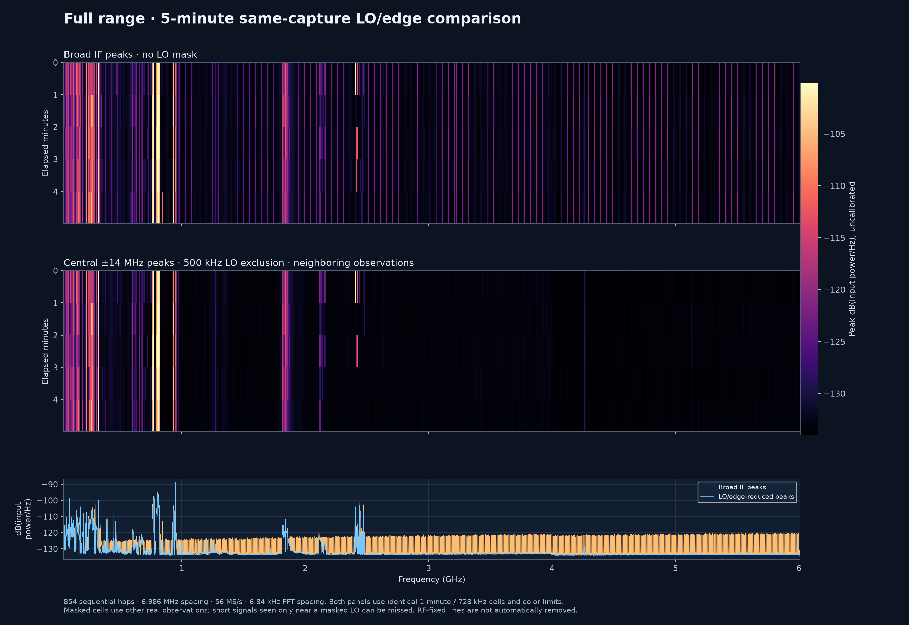
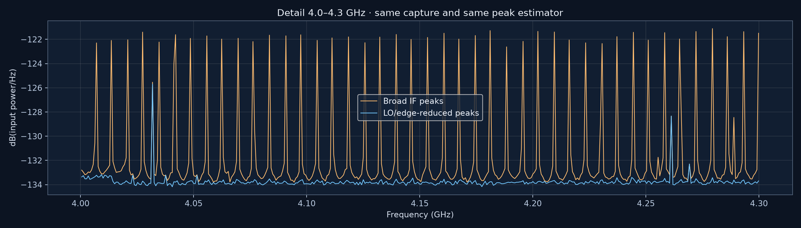

# From SDR scanning to defensible RF measurements

The useful question is what software can improve in tuning, acquisition,
estimation and measurement validity, and which quantities require a physical
reference. A visually level noise floor is not itself a calibration result.
This project has three separate evidence levels:

1. **Software verification:** numerical contracts and failure paths pass tests.
2. **Empirical hardware validation:** a specified receiver/setup passed particular
   acquisition and comparison experiments.
3. **Metrological calibration:** a stated measurand is connected to physical
   reference values, with a reference plane, validity domain and uncertainty.

The current antenna-only experiments establish parts of level 2. The software
contains additional calibration workflows, but their presence and simulated
unit tests do not establish level 3 for this physical receiver.

## What the five-minute comparison actually established

A B200mini captured 42–6008 MHz for 300 seconds with fixed gain, 56 MS/s,
8192-point Hann FFTs and 854 overlapping hops. All 7,137 saved acquisitions
were complete and timestamp-verified. There were eight full sweeps and a
partial final sweep; median full-band revisit interval was 35.85 seconds.

The comparison uses **the same new raw recordings**, identical one-minute and
728 kHz display cells, the same peak estimator and the same color limits.
It does not compare the amplitudes of unrelated five- and fifteen-minute runs.
The processed view retains central ±14 MHz and excludes a 500 kHz full-width
interval around the displayed origin. Neighboring hops supply real observations;
missing data are not reconstructed by interpolation.

For 415 actual hop centers in 3–5.9 GHz, the median displayed centre-to-flank
contrast changed from **11.389 to 0.214 dB**. Its upper 95th percentile changed
from **12.263 to 0.497 dB**. This is a signed display-density contrast: nearest
frequency cell minus the median cells 1–2 MHz away, after linearly averaging the
one-minute peak-cell densities over time. It is **not** integrated spur power,
dBc, SFDR, a confidence interval or ±0.214 dB amplitude accuracy.

A separate diagnostic aligned spectra by IF and examined three disjoint RF
regions. No additional narrow feature outside the central exclusion met the
selected recurrence criteria in all three regions. Consequently no further
frequency masks were invented. RF-fixed lines remain, regardless of whether
their ultimate origin is external RF or an internally generated fixed-frequency
product. Those causes require further discrimination experiments.

Here, raw evidence means uncalibrated PSD JSONL; individual complex-IQ samples
were not preserved.

This is **relative artefact suppression by measurement selection and overlap
fusion**. It is not an absolute gain calibration or a measured inverse response.
The acquisition grid and processing are reproducible from the
[full-range example](examples/ettus/README.md#five-minute-full-range-loedge-comparison).
Raw captures remain outside the repository; the included figures and result
summary are derived evidence, not the complete raw dataset.

## Correct terminology and remaining gaps

| Area | Established now | Still missing for a stronger RF claim |
|---|---|---|
| LO / tuning | Requested/actual output center, capability checks, stopped-stream retuning and overlapping observations. | Separate analog-LO and DSP-offset readbacks, explicit RF/IF mapping and source-based settling characterization. Output center need not equal physical LO. |
| DC | Driver correction policy and explicit exclusion of an observed centre artifact. | Input-referred DC/headroom characterization and a verified artifact location for each tuning mode. A mask removes observations, not analog DC. |
| IQ / images | Capability-checked controls and PSD diagnostics. | Known single-sideband reference tones, image-rejection measurements and calibrated complex correction. An image can look like a second real RF signal. |
| Lock | Pre-acquisition `lo_locked` gate plus configured settle/discard conditions. | Lock-validity logging through the record, empirical amplitude/frequency settling and a defined pass criterion. A lock bit is not phase coherence. |
| Time / continuity | Verified timestamps and sample counts within accepted acquisitions. | Simultaneous whole-band observation, independent clock accuracy and a proven UTC epoch. Retuning creates intentional observation gaps. |
| DSP / mathematics | Two-sided complex-IQ Welch density, periodic windows, linear-power averages, coverage and failure checks. | Physical IQ/full-scale calibration, measured effective uncertainty and RF tests under blockers, not just numerical agreement. |
| Frequency overlap | Redundant RF observations at different IF positions; normalized linear-PSD fusion. | Simultaneity and information about a burst seen only in an excluded observation. Frequency overlap differs from Welch time-frame overlap. |
| Dynamic range | Fixed-gain readbacks and rejection of reported transport loss. | Input compression, blocking, reciprocal mixing, IIP3, image/alias rejection and calibrated SFDR tests. Float precision cannot repair analog overload. |
| Power / noise | Uncalibrated delivered-stream density and explicit units. | Known reference-plane powers, impedance/path data, receiver-added noise and an uncertainty budget. Nominal gain is not dBm calibration. |

### Three immediate qualifications

**Driver span versus specified RF operation.** The driver accepted the tested
42–6008 MHz sampling plan. Ettus lists 70 MHz–6 GHz as the B2x0 RF operating
range. Treat 42–70 MHz and 6000–6008 MHz as outside that published range; neither
successful streaming nor plotted frequency support establishes specified RF
performance there. [Ettus B2x0 manual](https://files.ettus.com/manual/page_usrp_b200.html)

**Physical LO versus displayed zero.** UHD can split tuning between analog RF
and DSP. Under offset tuning, analog-LO/DC contamination can lie away from
output zero. The heatmap example's centre exclusion is restricted to the tested
default zero-offset configuration and rejects unverified tuning arguments for
fusion/masking. The receiver CLI has explicit raw-IQ `--dc-offset` support;
the actual artifact location still needs evidence. The current example does
not claim to infer it from a requested `OFFSET` alone.
[Ettus tuning notes](https://files.ettus.com/manual/page_general.html)

**RFIC calibration versus application power calibration.** B200-family native
RFIC correction is device-specific. The legacy daughterboard self-calibration
utilities must not be treated as universal B200mini commands. Separately, the
B200 family supports UHD's power-reference API, but measured physical calibration
data are required. Merely finding that API or reference-power keys does not
establish a calibrated unit.
[Ettus frontend calibration](https://files.ettus.com/manual/page_calibration.html),
[Ettus power controls](https://files.ettus.com/manual/page_power.html)

These links were checked on 2026-11-15; the live manual identified itself as
UHD 4.11. The experiments used UHD 4.10. Actual runtime capabilities/readbacks
remain the authority for which controls this installation exposes.

## Why an antenna or one termination cannot supply absolute calibration

A simple matched noise model is

`D = K(f_RF, f_IF, state) k_B (T_source + T_receiver)`.

`D` is delivered digital PSD, and `K` includes conversion to that digital scale.
One known load temperature gives one equation with both `K` and receiver noise
temperature unknown. An antenna adds unknown external signals/noise, impedance,
propagation and time variation. Dividing by the observed floor can remove
actual RF structure and still fail to identify gain. It is not a valid shortcut
to absolute calibration.

Likewise, scalar PSD cannot distinguish every genuine signal from an IQ image
or recover phase that was discarded. A useful complex-IQ model includes a
wanted path, a conjugate/image path, an additive offset and noise:

`y = a x + b conjugate(x) + d + n`.

Correcting the complex terms needs suitable reference observations and IQ data;
a smooth magnitude plot does not identify all of them. Linear equalization
cannot recover clipped samples or improve the underlying SNR.

## The calibration ladder: how far this can go

| Level | Physical evidence | Defensible result |
|---|---|---|
| Acquisition integrity | Hardware timestamps, counts, fixed state and repeatable control behavior. | Accepted records contain the intended sample sequence within stated limits. |
| Artifact discrimination | Retunes, changed IF positions and clock/rate tests; termination/antenna comparisons where available. | Conditional classification of LO-following, RF-fixed and clock-related features. No indiscriminate deletion of narrow lines. |
| Relative response | Stable high-SNR references observed redundantly at several IF/RF positions, interleaved repeats and independent validation. | Bounded relative response over the measured domain, with stationarity and separability assumptions. |
| Absolute scalar power | Calibrated CW source, characterized path loss and impedance, on/off captures and multiple input levels. | Input-referred dBm or dBm/Hz over a validated RF × IF × state grid. |
| Receiver noise / NF | Characterized hot/cold source, temperatures/ENR, losses/match and independently confirmed linearity. | Conditional equivalent input noise temperature and noise figure; not obtainable from a quiet-looking antenna interval. |
| Receiver plus external LNA | Receiver-only and cascade measurements with fixture losses and unchanged downstream state. | Gain/noise separation with conditional uncertainty, rather than treating a gain-register step as isolated-LNA characterization. |
| Vector response | Coherent complex references, raw IQ and appropriate calibrated fixtures/path measurements. | Complex gain/phase, delay and IQ-image characterization. Scalar PSD files alone are insufficient. |
| Traceable measurement system | Reference certificates, repeatability/drift tests, covariance, environmental/state coverage and independent holdouts. | A stated measurand, validity domain and uncertainty; not a universal perfect spectrum analyzer. |

For hot/cold noise under the matched linear model, `Y = P_hot/P_cold` and
`T_receiver = (T_hot - Y T_cold)/(Y - 1)`. Y near one is ill-conditioned.
For power-density measurements, channel power is integrated **in linear units**
over the supported bandwidth, then converted to logarithmic power. A peak
in dB/Hz is not channel power. Missing or masked support must remain explicit.

The ambitious endpoint is a measured response surface such as

`C(f_RF, f_IF, gain, rate, bandwidth, port/path, clock, correction_state, temperature)`

with source-level sweeps verifying linearity, drift/recheck rules, bounded
interpolation and independent validation. Not every axis needs a brute-force
uniform grid: adaptive measurements can add points where residuals, curvature
or uncertainty require them. Untested axes cannot simply be declared covered.

A UHD power-reference conversion and an application power profile must not both
be applied as if they were independent gain corrections. Retain and verify the
actual gain policy for the chosen conversion path.

Uncertainty must include source/path calibration, mismatch, repeatability,
interpolation, temperature and drift, including correlated terms. For first-order propagation,
`u_c^2 = J Cov(x) J^T`; averaging more frames does not remove a common systematic
error. An expanded uncertainty needs a stated coverage interpretation and
assumptions, not an automatic “2 sigma = guaranteed accuracy” label.
[NIST TN 1297](https://www.nist.gov/pml/nist-technical-note-1297/nist-tn-1297-5-combined-standard-uncertainty)

## What software and AI can usefully improve next

These are work packages, **not claims of implemented or calibrated behavior**.

1. **RF-state validity separate from transport integrity.** Record analog RF/BB
   tuning readbacks, lock before/after acquisition, temperature, correction state
   and an empirical settling-model identifier. Keep `complete samples`,
   `valid RF state` and `calibrated accuracy` as distinct statuses.
2. **Measure settling rather than guessing it.** With a stable reference,
   characterize tune-step amplitude/frequency transients for RF path, gain and
   clock changes. Choose the shortest delay/discard meeting a declared tolerance
   and validate it at unseen steps. Lock latency and RF settling are related but
   different quantities. Sensor polling alone cannot certify phase accuracy.
3. **A provenance-aware overlap combiner.** Export contributing hop IDs, support
   count, weight and acquisition-time range per output cell. Penalize stale or
   weak support and retain separate burst/peak and mean estimators. Current
   examples report aggregate coverage but not this full per-cell provenance.
4. **An evidence-backed spur atlas.** Track IF-fixed, RF-fixed and clock-dependent
   hypotheses through retunes, alternative rates/clocks and known reference
   states. Require held-out support before an exclusion rule is accepted;
   otherwise flag the feature and preserve it. The current recurrence check is
   a diagnostic experiment, not a general automatic birdie classifier.
5. **Automatic experiment design and instrument orchestration.** Use actual
   capabilities and an explicitly connected reference/switch to collect
   repeatable on/off and hot/cold grids, reserve holdouts and reject failed
   profiles. Source hooks, builders and acceptance checks already exist; a real
   reference chain has not been connected in these antenna-only sessions.
   A further proposed optimization is coarse analog-LO stepping with FFT or
   polyphase channelization inside each instantaneous band, where the backend
   exposes the necessary controls. This can reduce retuning overhead; it cannot
   turn 56 MHz instantaneous reception into simultaneous 6 GHz coverage.
6. **Measured uncertainty and useful adaptive scanning.** Optimize the Pareto
   tradeoff among revisit time, usable IF band, estimator variance, spur contrast
   and probability of intercept. Detection probability needs a specified signal
   duration/model and noise/false-alarm criterion; a gap-free display is not
   continuous RF coverage. Use a stable physical input for receiver drift/Allan
   analysis, not arbitrary antenna traffic.
7. **Triggered, bounded IQ evidence.** Preserve short IQ windows for suspected
   clipping, images, transients or phase tests. The current PSD capture is not
   an IQ recorder. At 56 MS/s, complex64 storage is 448 MB/s uncompressed, so
   continuous IQ storage and PSD-only storage have very different costs.

## Existing code versus physically validated scope

- `soapypower/power.py`, `integrity.py`, `frontend.py`: acquisition, controls,
  continuity and observable state. Native USB lifecycle/deadline controls were
  hardware tested on this B200mini.
- `examples/ettus/heatmap.py`: raw peak and normalized weighted linear-PSD
  display fusion with explicit exclusions and fixed-context gates.
- `passive_response.py`: repeated stable-source relative IF graph fitting with
  held-out validation. It must not be fed fabricated stationarity confirmations.
- `calibration_workflows.py`, `auto_calibration.py`: tone, hot/cold and other
  explicit reference workflows and publication gates. Absolute reference work
  has not been performed on this physical setup.
- `characterization.py`, `uncertainty.py`: conditional receiver/cascade fits,
  source-level checks and supplied uncertainty models.
- `response_smoothing.py`, `response_validation.py`, `equalization.py`: bounded
  response processing and independent validation. A smoother curve alone is
  not evidence that a profile is more accurate.

Data provenance (which samples/operations produced an output) is separate from
metrological traceability (its connection to physical standards).

A credible report should always name the measured quantity and distinguish
**implemented**, **software-tested**, **hardware-observed**, **calibrated**, and
**proposed**. That distinction is what makes cleaner scanning radiometrically
useful instead of merely visually convincing.
