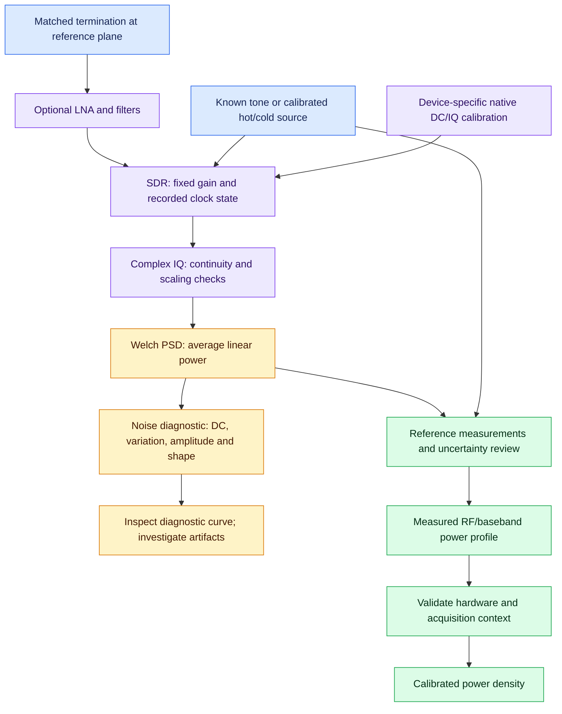

# Noise calibration audit and IQ diagnostics

The supplied Norwegian audit was reviewed as a proposal; its claimed ZIP and
implementation were not supplied. This release independently implements and
tests `soapypower/noise_audit.py`. A terminated noise response is diagnostic;
its inverse is never automatically installed as an absolute power correction.

| Area | Verified implementation and limit |
| --- | --- |
| Welch PSD | Periodic Hann, window-energy normalization, linear power averaging. |
| Absolute power | Existing measured RF/baseband grids require a known reference. |
| Noise shape | New offline complex IQ diagnostic, separate from power profiles. |
| DC | Raw density retained; central bins excluded from the diagnostic reference/correction. |
| High gain | Variation and amplitude warnings; analog compression needs physical source steps. |
| Noise figure | Existing hot/cold ENR Y-factor workflow; a single termination cannot determine NF. |
| Live acquisition | Existing Soapy PSD capture; this new CLI reads IQ files and does not record IQ automatically. |

## Run an audit

```sh
python -m soapypower.noise_audit terminated_capture.npy \
  --sample-rate 2400000 --fft-size 4096 --segments 128 \
  --output receiver_noise_diagnostic.json
```

The installed equivalent is `soapy_power_noise_audit`. Input must be a
one-dimensional complex64 or complex128 NumPy `.npy` array, not real/interleaved
samples, an archive, or a pickled object. Supply the actual sample rate and
optionally `--center-hz`. The file is memory mapped and SHA-256 identified;
frame-sized work bounds temporary sample memory. The report explicitly records
the analyzed prefix and unexamined tail. Existing output is protected unless
`--force` is supplied.

The default is 50% overlap, at most 128 complete frames, with no detrending.
Sample peaks, complex mean and threshold fractions count each examined sample
once. `--amplitude-threshold` is optional and must use the capture's known units.
Radial complex amplitude and maximum I/Q-component amplitude are reported
separately. A radial exceedance alone does not prove ADC clipping, and neither
metric proves analog linearity. No ADC full-scale or dBFS scale is guessed.

DC excess, segment-power span and coefficient of variation identify suspicious
behavior, not its cause. Their warning thresholds are adjustable. Overlapping
frame count is not an independent-average count or a confidence interval.
Zero-density logarithms are null, never an invented floor. Invalid selected
samples fail; unexamined tails are not silently certified as valid.

## Mathematics and interpretation

For each windowed complex frame, the two-sided density is
`abs(FFT(w*x))**2 / (sample_rate * sum(w**2))`. Average this density in linear
units before converting to dB. Integrating using `df = sample_rate / N` equals
the mean window-weighted sample power. Hann ENBW is reported separately from
bin spacing. Density units are input-amplitude-squared/Hz, not assumed dBm/Hz.

The off-DC positive-density median anchors the relative curve in dB. Its
negative is a display-only diagnostic curve; central excluded bins have no
suggested correction. This is not an estimate of transfer gain. The report's
`noise_diagnostic` type is rejected by the absolute power profile loader.

In general `Pout(f) = G(f) * Pin(f) + Nreceiver(f)`. For a thermal source a
linear equivalent-input model is `Pout = G*k*(Ts + Te)*B`. Receiver-added noise
prevents simply inverting the measured terminated noise shape to recover G.
Frequency-selective receiver noise, interference, mismatch and compression
further complicate interpretation. A stable narrow peak can remain stable
between segments; the variation diagnostic does not certify white noise.

The existing hot/cold workflow uses linear `Y = Phot/Pcold` and
`Te = (Thot - Y*Tcold)/(Y - 1)`, with `F = 1 + Te/T0`. Correct ENR/reference
temperature, matched reference plane, fixed gain, adequate Y separation and
linear operation are required. Known NF is a conditional external assumption,
not an NF measurement from a termination. See [CALIBRATION.md](CALIBRATION.md)
for accepted inputs and uncertainty limitations.

## Calibration workflow



The diagnostic branch has no automatic path to a power profile. The reference
measurements are mandatory for that branch. Native DC/IQ calibration is also
separate from gain/power calibration. Use hardware-specific procedures:
[bladeRF](BLADERF.md), [Ettus/USRP](ETTUS.md), and the general
[radio model](RADIO_THEORY.md).

## Verification and physical acceptance

Automated tests cover synthetic circular white noise and integrated PSD,
strong DC, segment variation, overlap-aware sample counts, diagnostic-only
corrections, zeros, invalid data, file provenance and output protection.
Device tests cover USRP clock coercion/rejection, serial/mapping context,
manual correction tolerances and separate RX/reference sensor gates.
These are software checks, not physical RF measurements.

Before relying on absolute results, measure source/gain linearity, RF/baseband
response, hot/cold noise, temperature drift and reference-plane losses with the
actual hardware. Put termination before the LNA for whole-chain measurements.
Use the correct impedance; 75-ohm/50-ohm mismatch cannot be ignored. Automatic
IQ recording, temperature characterization and physical hardware certification
are not provided by this offline diagnostic.

## Multi-temperature receiver and LNA characterization

The separate [receiver/LNA workflow](RECEIVER_CHARACTERIZATION.md) fits measured
source-temperature levels, checks CW/noise linearity and optionally propagates
joint correlated uncertainty. Its report is distinct from a power profile.

## Optional relative PSD equalization

See [EQUALIZATION.md](EQUALIZATION.md) for bounded measured-response shaping,
its distinction from absolute power/NF calibration, and corrections to the
room-correction report. This does not invert a terminated noise curve.

## Passive reference diagnostics

[PASSIVE_REFERENCES.md](PASSIVE_REFERENCES.md) adds relative IF overlap fitting,
fixed-gain-state comparison, selected-tone drift and active/quiet IQ intervals.
Public signals do not independently establish input dBm, receiver NF or phase.
