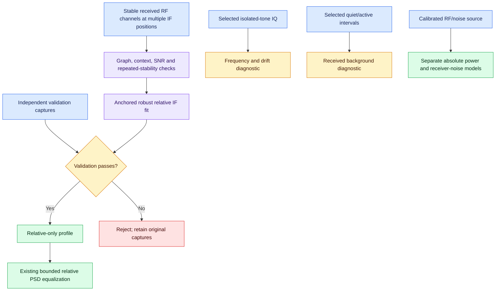

# Practical passive references and overlapping IF calibration

The three supplied reports were reviewed as proposals, not as implemented code
or evidence of physical calibration. The useful additions are now available as
offline capture-backed commands: overlapping IF-response fitting, gain-state
comparison, selected-tone frequency/drift checks and active/quiet IQ interval
diagnostics. They reuse the strict capture/context and equalization workflows.

## What was retained and corrected

| Idea | Implementation or limitation |
| --- | --- |
| Unknown public RF signals can constrain relative IF response | Added robust, anchored, redundant overlap fitting with repeated observations and independent validation. |
| Public transmitter power establishes absolute input power | Rejected. Transmitter power, antenna and propagation are unknown at the input plane. |
| GSM BCCH or TETRA MCCH is an unmodulated CW calibration source | Rejected. Use appropriately identified waveform intervals; a carrier label alone is insufficient. |
| GSM frequency-correction bursts can help frequency diagnostics | A selected isolated-tone IQ diagnostic is provided; burst discovery and GSM identification are not claimed. |
| DAB null intervals measure receiver NF | Rejected. Optional TII, other RF energy and transients can remain. Selected interval power is diagnostic only. |
| Pilot estimation reveals only receiver complex transfer | Rejected. The observed channel also includes transmitter, propagation and antenna response. |
| Changing gain registers isolates an internal LNA | Rejected. Added configuration-to-configuration gain comparison, not isolated-stage NF. |
| A short circuit necessarily clips and an open removes all noise | Rejected. Neither supplies a calibrated matched noise reference. |
| More averaging always fixes fading | Rejected. Common time/tuning-correlated changes can remain systematically confounded with response. |
| Automatic phase inversion from magnitude | Not inferred. Existing PSD-only regularization and masks remain distinct from complex-IQ filtering. |

Hot/cold source models, receiver/cascade characterization, known-source CW
linearity checks, explicit DC/spur masks and bounded response equalization were
already implemented. These remain the appropriate absolute/noise workflows.
No automatic public-band scanning, cellular identity decoder, LTE/DAB pilot
extractor, transmission, radio-setting mutation or background monitoring job is
started by the new commands. Protocol-specific extraction requires a separately
validated decoder rather than treating arbitrary broadcast samples as known data.

## Overlapping-frequency tomography

Measure the **same received RF channels** at several original raw-IQ baseband
positions without changing receiver or external-chain state. The model is

```text
measured_channel_db(signal, IF) = unknown_received_level_db(signal) + IF_response_db(IF) + error
```

Fix one observed IF response to zero. Absolute level, receiver NF, transmitter
phase, sample-clock error and separate RF/LO response are not identified by
this model. RF/IF separability over the campaign is an explicit assumption.
Two disconnected overlap components cannot be connected by a guessed gain.
Finite RF-channel integrations measure a spectrum-weighted band response, not
an exact pointwise transfer. The manifest therefore requires
`narrowband_response_confirmed=true` after checking local response flatness.
Signal integration width must also be at most `max_band_fraction` times the
smallest trained IF-knot spacing (default 0.1; maximum 0.25). This guard is not
proof that sub-band notches are absent. Broad GSM/TETRA/DAB occupied spectra
must not simply be treated as point tones; use sufficiently narrow stable
components or independently validate the band-response approximation.

### Capture plan

1. Choose at least two distinct RF channels received with high SNR. They may be
   public transmissions, lab sources or any suitable stable signal; no claimed
   standard identity is required by this power-only method.
2. Keep fixed gain with known actual gain-register readbacks, antenna, sample
   rate, bandwidth, clock, native corrections,
   external LNA/path and temperature as stable as practical. Avoid known DC/spur
   regions and unreliable edges. Select the same RF integration band for each
   channel at every tuning position; it must include the signal's relevant
   spectral energy and window leakage.
3. Retune to move each channel through the intended IF knots. Interleave return
   visits (for example A–B–C–A), rather than measuring all of one position first.
   Acquire at least two distinct repeats for each signal/IF edge and split.
4. Choose an adjacent, disjoint background band with locally representative
   noise/interference density. Background density times signal bandwidth is
   subtracted in linear power. This is a conditional local-background model;
   it does not measure receiver NF and can be biased by slope/interference.
5. Capture raw, uncalibrated JSONL with complete acquisition and actual tuned
   center/context metadata. No detrending, synthetic DC interpolation, partial
   measurement or estimated/masked signal/background support is accepted.
6. Collect fresh independent validation captures spanning every IF knot. Each
   validation channel must visit multiple IF positions. Unknown validation
   signal level is fitted only as a nuisance constant; the trained IF curve is
   frozen. Use fresh validation data after changing a campaign or acceptance
   rule, rather than tuning the curve repeatedly against the same holdouts.

[overlap-reference.json](examples/calibration/overlap-reference.json) contains
an explicitly incomplete template. Replace null standard errors with measured
**standard errors in dB**, not expanded uncertainty or FFT-segment scatter.
Set stationarity/path confirmations only after reviewing the actual campaign.
Each signal ID retains identical RF, signal and background bands. Repeat IDs
must be unique within an edge/split. The same PSD capture may measure several
RF channels; that does not make shared errors independent.

```sh
soapy_power_calibration overlap-fit overlap-reference.json --output relative-if.json
soapy_power_calibration validate relative-if.json
soapy_power_calibration equalize raw.jsonl --profile relative-if.json \
  --reference-rf-hz 915500000 --reference-baseband-hz 100000 \
  --mode attenuation-only --usable-policy usable-band.json \
  --output relative-flattened.jsonl
```

Anchor RF must be inside the observed RF span and anchor baseband inside the
measured IF grid. An explicit usable policy can mask unsupported bins rather
than extrapolate. The existing regularized inverse is available as an
alternative. A relative profile has its own `relative_if_response` type and is
accepted only by relative equalization/inspection. `PowerCalibration` rejects
it; live dBm calibration, absolute holdout validation and absolute-profile
smoothing cannot silently consume it.

### Solver and acceptance

The solver uses weighted least squares with Huber reweighting and an SVD rank/
condition check. Each training source must link at least two IF knots, each IF
knot must have at least two source references, the graph must be connected and
have redundant cycles. No regularization prior is used to invent missing links.
The campaign is bounded to 20000 observations and 512 source/IF nodes.

Defaults, all explicitly adjustable in the manifest:

| Check | Default |
| --- | --- |
| Complete Welch segments per capture | 32 |
| Repeats per signal/IF/split | 2 |
| Net channel/background SNR | 10 dB |
| Maximum repeated-edge span | 0.5 dB |
| Maximum absolute training residual | 0.25 dB |
| Maximum independent-validation residual | 0.25 dB |

Huber downweights are reported, never silently deleted. All training residuals,
including downweighted observations, must pass the configured gate. An
inconsistent campaign fails before publication. Capture hashes must be disjoint
between training and validation; repeating the same data at one edge under a
different filename/repeat label is rejected. Hashes cannot prove physical
independence when samples or timestamps were fabricated/repackaged.

Reported standard errors and normal-approximation 95% intervals are conditional
on supplied independent dB errors and the final robust weights. They exclude
weight-selection uncertainty, correlated fading, mismatch, RF/LO interaction and
other model bias. The anchor has zero **gauge** uncertainty, not perfectly known
physical gain. Residual tests cannot detect every fading pattern correlated
with tuning order. Capture host time bounds are retained when present; missing
timestamps are not invented and no phase-coherent timing is assumed.

The fitted response is linear-interpolated in dB inside the measured IF domain
and treated as separable over the observed RF span. Neither axis extrapolates.
This is not evidence for unmeasured bands, changed gain/clock settings or a new
antenna/propagation configuration. Record metadata retains the relative-only
status and the full campaign provenance.

## Gain-state comparison

Use repeated same-RF, same-IF observations in two fixed gain configurations:

```sh
soapy_power_calibration gain-compare gain-reference.json \
  --output gain-comparison.json --require-checks
```

[gain-reference.json](examples/calibration/gain-reference.json) is a template.
Only actual gain-register values may differ between the two contexts; all other
hardware, correction, DSP and path settings must match. AGC remains off. Each
configuration must be internally stable and every coordinate needs repeated
measurements. The same disjoint adjacent-background model and SNR requirement
apply. Interleave A/B/A observations under a stable source/path.

Reports include actual contexts, mean **linear power ratio converted to dB**,
repeat span/scatter and optional deviation from a declared nominal gain step.
Nominal register gain is a comparison target, not a traceable RF reference.
Default repeat-span and optional nominal-error gates are each 0.5 dB.
`--require-checks` writes failed diagnostics and returns status 1. Results do
not establish isolated internal-LNA gain/NF, absolute power or a universal
compression threshold. Source changes between sequential states can imitate
receiver changes even if nominal gain readback is correct.

## Selected-tone frequency and drift

```sh
soapy_power_calibration tone-audit selected_tone.npy \
  --sample-rate 2400000 --expected-baseband-hz 100000 \
  --reference-rf-hz 915100000 --frame-size 4096 --frames 128 \
  --search-hz 500 --min-tone-fraction 0.8 --output tone-diagnostic.json
```

Input is one-dimensional complex64/complex128 `.npy`, memory mapped without
pickle. Supply an isolated, already selected tone interval and the actual
sample rate. A lag-one phase estimate is checked against the declared search
range and coherent single-tone power fraction. The range must avoid DC and
Nyquist. At least two accepted complete frames are required; rejected indices,
accepted fractions and unused tail samples are explicit. Work is bounded to
10000 frames and 1048576 samples/frame.

The diagnostic reports raw-IQ frequency error, apparent error divided by the
nominal RF reference in ppm, and drift versus nominal sample time. Positive
error means observed raw-IQ frequency exceeds expected. This is **not** the
sign of a hardware PPM setter. Transmitter offset, Doppler, receiver LO and
sample-clock error can contribute simultaneously. No setting is applied, no
GSM identity is inferred, and no complete frequency-uncertainty budget exists.
A coherent interferer or a wrong nominal reference can pass these checks.

A selected GSM frequency-correction burst can supply a tone-like interval;
the entire BCCH channel cannot be treated as CW. Correctly account for burst
offset, IQ orientation, nominal RF reference and the applicable waveform. The
selected tone must last long enough for the chosen frames; short bursts need
shorter frames. This command does not discover FCCH/SCH bursts or synchronize
TETRA. It is not a generic estimator for modulated data/OFDM waveforms.

## Reduced-activity intervals

```sh
soapy_power_calibration interval-audit capture.npy --intervals activity-windows.json \
  --output activity-diagnostic.json
```

[activity-windows.json](examples/calibration/activity-windows.json) describes
sorted, nonoverlapping, in-bounds half-open sample ranges labeled `active` or
`quiet`. At least one of each is required. The command reports interval mean
raw power and sample-count-weighted means/ratio. It checks selected samples in
bounded chunks, does not certify unexamined samples, and supplies no absolute
scale, NF or protocol identity.

Operator-identified DAB reduced-activity intervals are one possible input.
The DAB synchronization structure includes a null and a phase-reference symbol,
but optional transmitter-identification content can occupy the null interval.
Propagation tails, other transmitters, interference and transients can also
remain. None of these intervals is interchangeable with a matched laboratory
cold load. Known pilot/phase-reference sequences estimate a combined channel;
separating receiver phase would need validated coherent reference extraction.

## Integration and provenance

All commands are offline, write strict JSON atomically, require explicit
`--force` to replace output, and forbid overwriting their input manifests, IQ
or listed capture evidence. Original captures remain untouched. Relative
profiles feed the existing equalizer with explicit masks and boost limits;
equalized captures remain rejected by reference-building workflows.

The four models constrain different things rather than blindly fusing units:



Reference structures are described in
[ETSI TS 145 002, frequency-correction burst](https://www.etsi.org/deliver/etsi_ts/145000_145099/145002/05.09.00_60/ts_145002v050900p.pdf)
and [ETSI EN 300 401 V2.1.1, synchronization channel](https://www.etsi.org/deliver/etsi_en/300400_300499/300401/02.01.01_60/en_300401v020101p.pdf).
These citations support waveform structure, not a claim that this software
implements a standards-compliant decoder or traceable public-signal calibrator.
The reports' hardware specifications, source rankings, broad permission claims
and placeholder references are not adopted as verified facts.

Synthetic tests exercise known IF response, graph disconnection, robust
outliers, repeat/validation instability, context and reuse rejection, relative
profile integration, gain changes, tone drift and interval classifications.
Physical public-band/SDR campaigns and protocol-specific reference extraction
remain unverified. See [CALIBRATION.md](CALIBRATION.md),
[RECEIVER_CHARACTERIZATION.md](RECEIVER_CHARACTERIZATION.md) and
[FLATTENING.md](FLATTENING.md) for the existing measured workflows.
