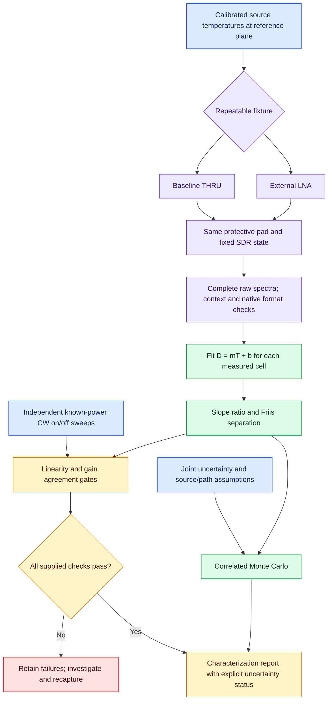

# Receiver and external-LNA noise/gain characterization

This extends the supplied Norwegian multi-temperature report with a separate
`ReceiverCharacterization` implementation and offline capture workflow. The
report is review input, not evidence that its proposed features or physical
measurements already exist. Its embedded citation tokens are not source links.
The hardware prices and purchasing examples have not been adopted or verified.

## Audit decisions

| Proposal | Implementation / interpretation |
| --- | --- |
| One terminated noise curve cannot identify both gain and noise | Retained; the IQ noise audit stays diagnostic. |
| Fractional-bin integration was missing | Already implemented and used by reference workflows; retain explicit bin-overlap integration. |
| Calibrated hot/cold model was missing | Already implemented with actual cold temperature, ENR and passive path temperature; retain. |
| Multi-temperature receiver/cascade separation | Added capture-backed OLS fits, scalar Friis extraction and failure reporting. |
| Use normal equations for weighted fits | Replaced by centered/scaled SVD; conditional WLS is also available through the Python API. |
| Per-frequency uncertainty | Each measured RF/baseband cell reports conditional fit covariance and optional joint-input Monte Carlo intervals. |
| Compression gating | Noise contrast/residual gates and independent CW slope/residual/gain comparison; missing evidence is explicitly incomplete. |
| Native format/full-scale | Captured in strict hardware context when exposed; never converted into volts or guessed CF32 clipping limits. |
| Internal gain stage as isolated LNA | Forbidden inference; select configuration comparison without LNA extraction. |
| Full vector mismatch/de-embedding | Not implemented; this is a conditional matched scalar model. |

## Physical model

At a given measurement cell, fit linear digital density against known source
noise temperature at the reference plane:

```text
D(T) = m*T + b
Te = b/m
Kdigital = m/kB
input_power_offset_db = 10*log10(1000*kB/m)
```

For baseline receiver R and cascade C, only when the entire downstream
conversion and RF chain remain identical:

```text
GL = mC/mR
TeL = TeC - TeR/GL
NFL = 10*log10(1 + TeL/290)
```

This cancels the unknown digital scaling. It does not establish analog voltage
gain, ADC volts/code, vector-corrected available gain, or topology from a gain
name. Negative temperatures are retained and flagged; they are not clipped to
zero or silently hidden by dropping input points.

Each cell is a **band-averaged** estimate. For response that varies substantially
within the integration band, the fitted noise temperature is gain-weighted;
it is not necessarily the noise temperature at the center bin. Use sufficiently
narrow measured bands/cells and check frequency flatness. There is no report
interpolation, extrapolation or automatic power-profile export.

## Bench procedure

1. Warm up the hardware. Disable AGC, preserve actual gains, bandwidth, rate,
   clock source and native correction state. Record source/DUT/receiver thermal
   conditions, source certificate, fixture identity and actual reference plane.
2. Establish a baseline path with a calibrated THRU and a protective pad feeding
   the SDR. Keep the same pad and every downstream setting for the DUT path.
   The scalar extraction assumes an ideal THRU or correctly deembedded fixture;
   unknown THRU loss does not cancel automatically.
3. Establish at least three distinct known temperatures at the input plane for
   each configuration; more levels and repeats improve curvature/drift checks.
   A single hot/cold pair cannot validate linearity and is rejected by this
   multi-level workflow. Existing two-state power calibration remains available.
4. Capture each level with raw linear output, complete acquisitions and strict
   context metadata. For example, use a device-appropriate command based on:

   ```sh
   soapy_power -d 'driver=uhd,serial=REPLACE' -f 914900000 -r 2400000 \
     -b 4096 -n 128 -g 20 -F json -l -O captures/receiver_cold.jsonl
   ```

   Choose actual device gain/rate/channel/antenna and settling/lock options.
   Here 915 MHz is measured at +100 kHz raw baseband. Do not use an unsupported
   device setting simply because it appears in this example. Capture separately
   at each source state and validate its physical switching and stability.
5. Insert the external LNA and repeat. Do not reduce SDR gain to accommodate it;
   choose a protective pad that keeps both configurations linear. Internal gain
   changes require `configuration-comparison`, not isolated LNA claims.
6. Independently capture CW on/off at three or more known **reference-plane**
   source powers for both configurations. The CW must fall inside the integration
   band, sufficiently far from its edges to include leakage. Subtract the
   baseline in linear power. Each level requires at least 10 dB net-tone SNR.
7. Fill [the manifest template](examples/calibration/receiver-characterization.json)
   using actual captures and temperatures, then run:

   ```sh
   soapy_power_calibration characterize receiver-characterization.json \
     --output characterization.json
   ```

   Relative capture paths resolve against the manifest directory. Existing output
   requires explicit `--force`. Add `--require-checks` to save the report and return
   exit status 1 when any measured checks fail. Source and manifest/capture SHA-256 provenance
   are retained. A report hash is an integrity identifier, not a digital signature.

The source temperatures must already include path losses and passive emission:
`Tplane = transmission*Tsource + (1-transmission)*Tpath`. This helper exists as
`effective_temperature()`. Different temperatures/path temperatures may be
needed per frequency and configuration. ENR tables and their uncertainty belong
to the actual noise-source certificate; a nominal model number is insufficient.
The workflow deliberately does not invent an ENR table or control a noise source.

Do not use a 75-ohm load as an ideal matched reference for a 50-ohm receiver.
Resistive transfer alone cannot account for source-dependent noise waves. Use
measured S parameters and a suitable vector noise model where mismatch matters.

## Checks and acceptance

The entire supplied noise/CW range is fitted; points are never automatically
removed to improve a result. Defaults are engineering targets, not universal RF
specifications. They can be set in the manifest:

| Manifest option | Default | Check |
| --- | --- | --- |
| `min_segments` | 32 | Complete Welch segments per capture; not independent averages. |
| `min_density_span_db` | 0.5 | Measured noise-level contrast for each configuration. |
| `max_noise_residual_db` | 0.10 | Maximum absolute measured/predicted noise residual. |
| `max_cw_residual_db` | 0.10 | Maximum CW fit residual. |
| `cw_slope_tolerance` | 0.01 | Absolute departure from 1 dB/dB slope. |
| `max_cw_noise_gain_delta_db` | 0.20 | Absolute independent CW versus noise gain difference. |

Capture geometry, masked/estimated-bin state and DSP processing must match
within each cell. Complete fixed-gain context must match all levels within a
configuration and also both configurations for external-LNA extraction.
Uncalibrated densities are mandatory. Native format/full-scale and hardware-time
capability, when exposed, are stored within hardware identity; older profiles
without these fields may require recapture. Native full-scale does not define
the clipping threshold of the CF32 conversion. Older Python bindings with an
unusable native-format output parameter explicitly record
`unavailable_python_binding`; no scale is guessed and no pointer workaround is
attempted. See the [upstream binding issue](https://github.com/pothosware/SoapySDR/issues/399). Masked or estimated integration support,
detrending and synthetic DC interpolation are rejected. Exclude actual DC/spur
regions by measurement-band choice; this routine does not auto-detect every
interferer or alter the selected integration band.

`passed_measured_checks` means those checks passed for supplied observations;
it does not mean precision metrology approval. Missing CW data reports failed
checks. Missing joint uncertainty reports `incomplete_uncertainty`. No report is
accepted as a live `PowerCalibration`, and NF is never added to or subtracted
from signal-power correction.

CW range checks do not establish P1dB or ensure hot Gaussian noise avoids analog
or ADC overload. Check hot noise separately, preserve protective attenuation,
and establish safe margins and independent reference drift before/after each
run. Digital peak inspection alone cannot detect upstream analog compression.
No software can infer coupler reversal, incorrect cables or a mislabeled source
certificate from spectral data alone.

## Uncertainty and correlations

`fit_noise_temperature(T, D, density_std=None)` uses centered/scaled SVD without
normal equations. It reports slope/intercept covariance and propagated Te
standard error. With supplied density standard errors it uses independent-error
WLS; without them it estimates scatter with N-2 degrees of freedom. Both assume
exact source temperatures and cannot serve as the total uncertainty budget.
Overlap count is never treated as independent sample count. OLS/WLS are
conditional estimators; Monte Carlo propagation does not turn them into an
errors-in-variables estimator or remove large predictor-error bias. Use a
validated source/error model when temperature uncertainty is substantial.

For each external-LNA cell an optional `joint_uncertainty` object contains:

```json
{
  "standard_uncertainties": [0, 0, 0, 0, 0, 0, 0, 0, 0, 0, 0, 0],
  "correlation": "REPLACE with a numeric 12 by 12 correlation matrix",
  "draws": 2000,
  "seed": 2028
}
```

This example illustrates **three levels per configuration** and is not an
uncertainty declaration. Supply actual nonnegative standard uncertainties and
numeric matrix. Vector order is all receiver temperatures, receiver densities,
cascade temperatures, cascade densities, preserving capture order. Sizes may
differ between configurations. A symmetric positive-semidefinite unit-diagonal
correlation matrix is required, including zero-uncertainty quantities. Shared
ENR/temperature, fixture and digital scale errors can be correlated across
levels and configurations; independence is not silently assumed.

Monte Carlo refits each sampled realization with OLS and preserves those joint
correlations. Bounds: 128–20000 draws and at most 512 input quantities per cell.
Results include standard deviations and 2.5/97.5-percentile intervals under the
supplied joint Gaussian model. No claim of exact coverage probability or
complete uncertainty is made. Invalid or negative-temperature realizations are
counted and cause intervals to be withheld, rather than silently truncating the
distribution. Use a more appropriate source distribution/model near physical
boundaries. These intervals do not automatically combine systematic terms that
were omitted, and conditional WLS fit errors are not added a second time.

For precision work include source ENR/temperature, correlated losses, mismatch,
repeatability, drift, source switching, fit inadequacy and residual compression
in the input/model budget. Temperature, path and source readbacks still need
physical instrumentation and traceable records. A bare repeatability estimate
or zero-filled covariance is not evidence of perfect accuracy.

## Colored measurement flow



## References and limits

The scalar two-stage correction and gain ratio follow
[Keysight's Y-factor measurement guide](https://www.keysight.com/us/en/assets/9018-04256/user-manuals/9018-04256.pdf).
The source-temperature linearity and fixed-gain requirements are described in
[Keysight's noise measurement fundamentals](https://www.keysight.com/us/en/assets/7018-06808/application-notes/5952-8255.pdf).
Native format/full-scale and hardware-time capabilities follow the
[SoapySDR Device API](https://pothosware.github.io/SoapySDR/doxygen/latest/classSoapySDR_1_1Device.html).
Full-scale describes native sample coding, not the physical RF input voltage.

Synthetic tests verify scale invariance, known Friis recovery, conditional
covariance against an independent design matrix, correlated uncertainty,
negative values, curvature, CW compression, context failures, capture provenance
and CLI output protection. No physical SDR/LNA measurements were performed.
