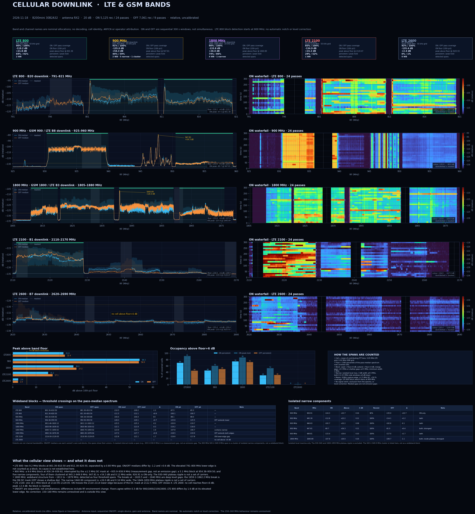
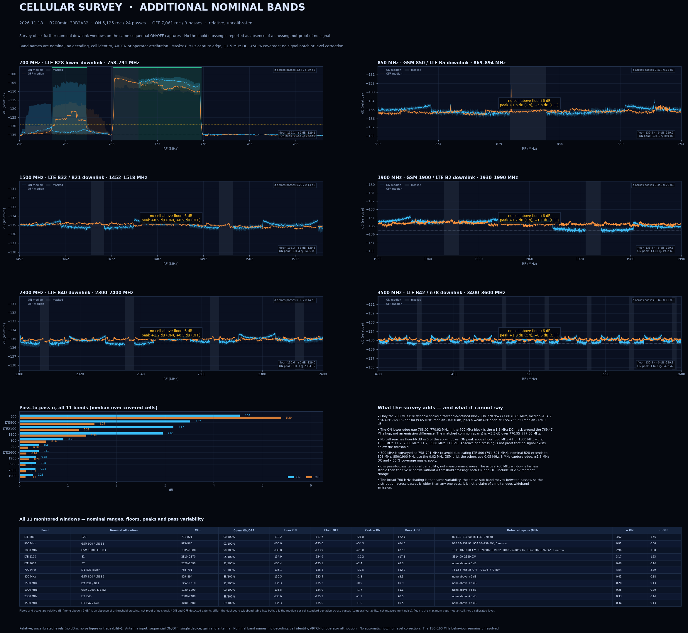
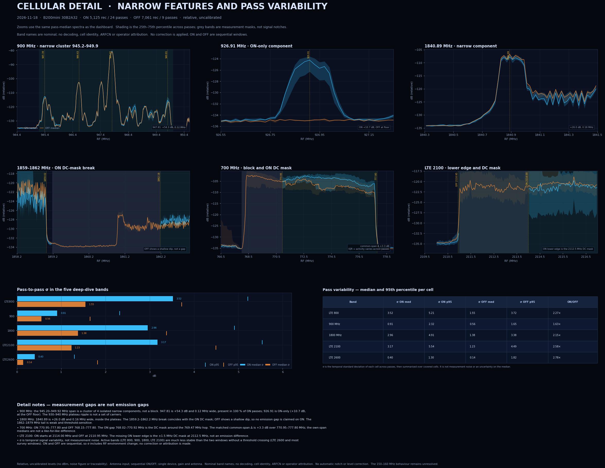

# Cellular downlink: LTE and GSM bands

Relative, uncalibrated analysis of the `fullrange-20261118-111658` captures.
The input was an antenna on RX2; ON and OFF are sequential 300 s windows, not
simultaneous measurements. All levels are relative. No dBm, noise figure,
absolute floor or traceability is claimed.

Band and channel names are **nominal allocations** (LTE B20/B8/B3/B1/B7/B28/B5/
B32/B21/B2/B40/B42, GSM 850/900/1800/1900 downlink). No decoding, cell identity,
ARFCN or operator attribution is attempted.

A finer-grid (10 kHz) follow-up on the same captures is in
[MODULATION.md](MODULATION.md): plateau-referenced morphology, the ~45 kHz
spectral raster against quiet controls, pass-scale level/centroid tracks and
narrow-component correlations. It is spectral-only and does not demodulate.







## Scope and method

| | |
|---|---|
| Session | `fullrange-20261118-111658` |
| Device | B200mini `30B2A32`, antenna `RX2`, 20 dB |
| Deep dive | LTE 800 (B20), 900 MHz (GSM 900 / LTE B8), 1800 MHz (GSM 1800 / LTE B3), LTE 2100 (B1), LTE 2600 (B7) — nominal downlink ranges |
| Survey | 700 MHz (B28 lower, 758–791), 850 MHz (GSM 850 / B5, 869–894), 1500 MHz (B32/B21, 1452–1518), 1900 MHz (GSM 1900 / B2, 1930–1990), 2300 MHz (B40, 2300–2400), 3500 MHz (B42/n78, 3400–3600) — nominal |
| Grid | 0.05 MHz LTE; 0.02 MHz GSM |
| ON | 5,125 records, 24 pass groups (last incomplete) |
| OFF | 7,061 records, 9 pass groups (last incomplete) |

Each capture is a 56 MHz FFT. A cell is the mean of the contributing bin dB
values; cells with fewer than 50 % of the pass groups covered are masked.
Capture edges (8 MHz) and DC (±1.5 MHz around the tuned center) are excluded.
These are measurement-quality masks, not signal notches. No level correction is
applied. A masked interval can fall inside a detected span; it is never counted
as an emission gap. LTE 800 block detection starts at 800 MHz, and the elevated
791–800 MHz structure is reported separately rather than notched.

A **wideband block** is seeded where the 0.2 MHz smoothed pass-median exceeds
the band floor +6 dB, extended while the unsmoothed median exceeds floor +4 dB,
and merged across gaps shorter than 0.5 MHz or shallow gaps up to 3.5 MHz; the
minimum width is 1 MHz. A span containing at least two isolated narrow
components and a median less than 12 dB above floor is labelled a **narrow
cluster**, not a wideband block.

A **narrow component** is an isolated local maximum with a 3 dB width of at
most 0.5 MHz and both 0.2–0.5 MHz side windows at least 9 dB below the peak.
Plateau ripple is not counted. Floors are the 10th percentile of the
pass-median spectrum over covered cells.

Where ON and OFF detected extents differ, the **matched common span** is their
intersection. The reported Δ is ON−OFF over that intersection, so a weak-edge
extent difference does not masquerade as a level difference. The own-span
medians are listed separately for reference.

**Pass-to-pass σ** is the temporal standard deviation of each cell across pass
groups, summarised over covered cells. It measures how much the band changed
between passes, not measurement noise, and it is not an uncertainty on the
median.

## Coverage and floors

| Band | Range (MHz) | Grid | ON cover | OFF cover | ON floor | OFF floor | Δ floor |
| --- | ---: | ---: | ---: | ---: | ---: | ---: | ---: |
| LTE 800 | 791–821 | 50 kHz | 90% | 100% | -119.23 | -117.63 | -1.60 |
| 900 MHz | 925–960 | 20 kHz | 91% | 100% | -134.98 | -135.03 | +0.05 |
| 1800 MHz | 1805–1880 | 20 kHz | 90% | 100% | -133.79 | -133.95 | +0.16 |
| LTE 2100 | 2110–2170 | 50 kHz | 85% | 100% | -134.86 | -134.92 | +0.06 |
| LTE 2600 | 2620–2690 | 50 kHz | 92% | 100% | -135.37 | -135.08 | -0.30 |

The LTE 800 floor is set by the elevated 791–796 MHz structure, not by the two
wideband blocks; ON is 1.60 dB below OFF there, and the ON plan also masks
796–799 MHz with the DC gap. The other four floors agree within 0.3 dB. The
difference is reported, not corrected.

## Band summary

| Band | ON floor | ON peak | ON +floor | ON persistent | ON peak-hold | OFF floor | OFF peak | OFF +floor | OFF persistent |
| --- | ---: | ---: | ---: | ---: | ---: | ---: | ---: | ---: | ---: |
| LTE 800 | -119.23 | -97.46 | +21.8 | 68.9% | 90.6% | -117.63 | -95.28 | +22.4 | 43.8% |
| 900 MHz | -134.98 | -80.66 | +54.3 | 44.4% | 59.4% | -135.03 | -81.05 | +54.0 | 49.1% |
| 1800 MHz | -133.79 | -107.78 | +26.0 | 73.7% | 86.3% | -133.95 | -106.67 | +27.3 | 71.6% |
| LTE 2100 | -134.86 | -119.65 | +15.2 | 29.4% | 52.2% | -134.92 | -117.83 | +17.1 | 30.0% |
| LTE 2600 | -135.37 | -132.98 | +2.4 | 0.0% | 1.0% | -135.08 | -132.81 | +2.3 | 0.0% |

`persistent` = fraction of covered cells whose pass-median exceeds floor +6 dB.
`peak-hold` = fraction whose 95th percentile across passes exceeds floor +6 dB.
Peak is the maximum pass-median cell, not a calibrated level.

## Wideband blocks

| Band | ON span (MHz) | OFF span (MHz) | ON med | OFF med | Δ common | ON pk | OFF pk | Note |
| --- | ---: | ---: | ---: | ---: | ---: | ---: | ---: | --- |
| LTE 800 | 801.30–810.50 | 801.30–810.50 | -110.5 | -109.2 | -1.2 | -97.5 | -95.3 | — |
| LTE 800 | 811.30–820.50 | 811.30–820.50 | -111.5 | -112.1 | +0.6 | -100.1 | -100.7 | — |
| 900 MHz | 930.34–939.92 | 930.34–939.88 | -104.4 | -104.4 | 0.0 | -98.1 | -98.0 | — |
| 900 MHz | 954.38–959.50 | 950.50–959.50 | -128.3 | -129.1 | -0.2 | -125.8 | -125.5 | OFF extends lower |
| 1800 MHz | 1811.48–1820.12 | 1811.12–1820.12 | -125.5 | -125.3 | -0.3 | -120.9 | -119.7 | — |
| 1800 MHz | 1820.98–1839.02 | 1820.98–1839.02 | -122.1 | -121.8 | -0.3 | -119.2 | -118.0 | — |
| 1800 MHz | 1840.72–1859.02 | 1840.70–1859.02 | -123.9 | -122.1 | -1.9 | -107.8 | -106.7 | contains narrow |
| 1800 MHz | 1862.18–1876.06 | 1861.00–1878.94 | -127.0 | -127.7 | +0.5 | -118.5 | -119.9 | OFF extends both edges |
| LTE 2100 | 2114.00–2129.05 | 2110.95–2129.05 | -122.8 | -121.1 | -1.8 | -119.6 | -117.8 | ON lower-edge gap |
| LTE 2600 | — | — | — | — | — | — | — | no cell above +6 dB |

Extents are threshold crossings on the median spectrum, not channel bandwidths.
Δ is the ON−OFF difference over the matched common span (the intersection of
the two extents), so unequal extents do not bias it. The ON and OFF medians are
each variant's own sub-block values and are shown for reference. A masked
interval inside a span (for example 935.9–938.9 MHz in the 900 MHz block) is a
measurement gap, not an emission gap. The 900 MHz 945.2–949.9 MHz span is a
cluster of isolated narrow components, not a wideband block.

## Narrow components

| Band | MHz | ON level | Above floor | 3 dB width | Persistence | OFF level | Δ ON−OFF | Note |
| --- | ---: | ---: | ---: | ---: | ---: | ---: | ---: | --- |
| 900 MHz | 926.91 | -124.3 | +10.7 | 0.16 | 92% | -135.0 | +10.7 | ON only; at OFF floor |
| 900 MHz | 945.39 | -112.8 | +22.2 | 0.12 | 100% | -114.1 | +1.2 | both |
| 900 MHz | 946.63 | -102.7 | +32.2 | 0.08 | 100% | -102.6 | -0.1 | both |
| 900 MHz | 947.81 | -80.7 | +54.3 | 0.12 | 100% | -81.0 | +0.4 | both; strongest |
| 900 MHz | 949.81 | -115.4 | +19.6 | 0.10 | 100% | -117.0 | +1.7 | both |
| 1800 MHz | 1840.89 | -107.8 | +26.0 | 0.16 | 100% | -106.7 | -1.1 | both; inside 1800 plateau; strongest |

Only isolated components are listed. The 930–940 and 1849–1859 MHz plateau
ripple is excluded and is not counted as distinct carriers.

## Per-band notes

### LTE 800 (B20)

- Two adjacent 9.20 MHz blocks at 801.30–810.50 and 811.30–820.50, separated by
  a 0.80 MHz gap at ~811 MHz. ON/OFF block medians differ by -1.2 dB and
  +0.6 dB.
- The elevated 791–800 MHz lower edge is not counted as an emission block; its
  cause is not established here. The block-edge peaks at 801.38 and 811.38 MHz
  are part of the blocks, not separate narrow components.
- The ON/OFF floor difference of 1.60 dB comes from the elevated
  lower edge, not from the blocks, and is not corrected.

### 900 MHz (GSM 900 / LTE B8)

- **930.34–939.92 MHz**: ~9.6 MHz wideband block. The ON median is masked at
  ~935.9–938.9 MHz by the ±1.5 MHz DC mask around the 937.36 MHz hop center;
  this is a measurement gap, not an emission gap, and the block is detected
  across it. The 930–940 MHz plateau ripple is not a set of carriers.
- **954.38–959.50 MHz**: ~5.1 MHz block. OFF extends lower to 950.50 MHz; ON
  crosses the seed threshold only from 954.38 MHz. The ON 951–954 MHz cells are
  near threshold, so the exact lower edge is method-sensitive.
- **945.20–949.92 MHz**: a cluster of four isolated narrow components
  (945.39, 946.63, 947.81, 949.81 MHz), not a wideband block. 947.81 MHz is the strongest at
  +54.3 dB and 0.12 MHz wide. 926.91 MHz, outside the
  cluster, is ON-only (+10.7 dB, 92 % of ON
  passes, at the OFF floor); it is not attributed to a transmitter or to the
  feature bundle.

### 1800 MHz (GSM 1800 / LTE B3)

- Wideband structure from ~1811 to ~1879 MHz, detected as four threshold spans.
  The breaks at ~1820.5 MHz (0.9 MHz) and ~1840 MHz (1.7 MHz) are deep level
  gaps. The ~1831–1834 MHz ON gap is the ±1.5 MHz DC mask around the
  1832.70 MHz hop center, not an emission gap. The 1859.2–1862.2 MHz break
  coincides with the ON DC mask; OFF shows a shallow dip there, so the two
  sides are not claimed to be separated by a real emission gap on ON.
- The narrow component at 1840.89 MHz is +26.0 dB and
  0.16 MHz wide; it sits inside the 1840.7–1859.0 MHz block.
  The 1849–1859 MHz plateau ripple is not counted as distinct carriers.
- The 1862–1879 MHz span is weaker. The ON detected span stops at 1876.06 MHz
  where a narrow dip crosses the extension threshold, while OFF reaches
  1878.94 MHz; this is a weak-tail threshold effect, not a verified
  differential fade. It is not claimed as a verified allocation.

### LTE 2100 (B1)

- One 18.10 MHz block at 2110.95–2129.05 MHz. ON detects 2114.00–2129.05 MHz;
  the missing lower 2110–2114 MHz edge is the ±1.5 MHz DC mask at 2112.5 MHz,
  not an emission difference. OFF shows the lower edge.
- The block has a sawtooth/ripple structure; only the block extent is claimed.
  No isolated narrow component survives the isolation test.

### LTE 2600 (B7)

- No cell reaches floor +6 dB in either variant. The ON peak median is
  +2.4 dB above the 10th-percentile floor at 2625.93 MHz;
  OFF is +2.3 dB.
  No wideband or narrow block is claimed. Absence of a threshold crossing is
  not proof that no signal exists below the threshold.

## Survey: additional nominal bands


The survey applies the same cells, masks, floor, block and narrow rules to six
further nominal downlink windows. The same 11-band metrics are tabulated below.

| Band | Nominal allocation | MHz | Cover ON/OFF | Floor ON | Floor OFF | Peak + ON | Peak + OFF | Detected spans (MHz) |
| --- | --- | ---: | ---: | ---: | ---: | ---: | ---: | --- |
| LTE 800 | B20 | 791–821 | 90/100% | -119.23 | -117.63 | +21.8 | +22.4 | 801.30–810.50; 811.30–820.50 |
| 900 MHz | GSM 900 / LTE B8 | 925–960 | 91/100% | -134.98 | -135.03 | +54.3 | +54.0 | 930.34–939.92; ON 954.38–959.50 / OFF 950.50–959.50; 5 narrow |
| 1800 MHz | GSM 1800 / LTE B3 | 1805–1880 | 90/100% | -133.79 | -133.95 | +26.0 | +27.3 | ON 1811.48–1820.12 / OFF 1811.12–1820.12; 1820.98–1839.02; 1840.72–1859.02; ON 1862.18–1876.06 / OFF 1861.00–1878.94; 1 narrow |
| LTE 2100 | B1 | 2110–2170 | 85/100% | -134.86 | -134.92 | +15.2 | +17.1 | ON 2114.00–2129.05 / OFF 2110.95–2129.05 |
| LTE 2600 | B7 | 2620–2690 | 92/100% | -135.37 | -135.08 | +2.4 | +2.3 | none above +6 dB |
| 700 MHz | LTE B28 lower | 758–791 | 91/100% | -135.06 | -135.30 | +32.5 | +32.9 | 761.55–765.35 OFF; ON 770.95–777.80 / OFF 768.15–777.80 |
| 850 MHz | GSM 850 / LTE B5 | 869–894 | 88/100% | -135.46 | -135.43 | +1.3 | +3.3 | none above +6 dB |
| 1500 MHz | LTE B32 / B21 | 1452–1518 | 91/100% | -135.32 | -135.24 | +0.9 | +0.9 | none above +6 dB |
| 1900 MHz | GSM 1900 / LTE B2 | 1930–1990 | 90/100% | -135.49 | -134.91 | +1.7 | +1.1 | none above +6 dB |
| 2300 MHz | LTE B40 | 2300–2400 | 88/100% | -135.56 | -135.20 | +1.2 | +0.5 | none above +6 dB |
| 3500 MHz | LTE B42 / n78 | 3400–3600 | 89/100% | -135.31 | -135.03 | +1.0 | +0.5 | none above +6 dB |

"Detected spans" lists threshold crossings only. "none above +6 dB" means no
cell reached the seed threshold; it is not proof that no signal exists below
that threshold.

- **700 MHz (B28 lower, 758–791 MHz)**: the only survey window with a threshold-defined block. ON 770.95–777.80 (6.85 MHz, median -104.2 dB); OFF 768.15–777.80 (9.65 MHz, median -106.6 dB). A weak OFF-only span at 761.55–765.35 (median -126.1 dB) is below the ON threshold. The ON gap 768.02–770.92 MHz is the ±1.5 MHz DC mask around the 769.47 MHz hop; the matched common-span Δ is +3.3 dB over 770.95–777.80 MHz. The survey stops at 791 MHz to avoid duplicating LTE 800; nominal B28 extends to 803 MHz.
- **850 MHz (GSM 850 / LTE B5, 869–894 MHz)**: no cell reaches floor +6 dB. ON peak +1.3 dB, OFF +3.3 dB. Floors differ by -0.03 dB. Pass-to-pass σ is 0.41 dB ON and 0.18 dB OFF. Absence of a crossing is not proof that no signal exists below the threshold.
- **1500 MHz (LTE B32 / B21, 1452–1518 MHz)**: no cell reaches floor +6 dB. ON peak +0.9 dB, OFF +0.9 dB. Floors differ by -0.08 dB. Pass-to-pass σ is 0.28 dB ON and 0.13 dB OFF. Absence of a crossing is not proof that no signal exists below the threshold.
- **1900 MHz (GSM 1900 / LTE B2, 1930–1990 MHz)**: no cell reaches floor +6 dB. ON peak +1.7 dB, OFF +1.1 dB. Floors differ by -0.58 dB. Pass-to-pass σ is 0.35 dB ON and 0.20 dB OFF. Absence of a crossing is not proof that no signal exists below the threshold.
- **2300 MHz (LTE B40, 2300–2400 MHz)**: no cell reaches floor +6 dB. ON peak +1.2 dB, OFF +0.5 dB. Floors differ by -0.37 dB. Pass-to-pass σ is 0.33 dB ON and 0.14 dB OFF. Absence of a crossing is not proof that no signal exists below the threshold.
- **3500 MHz (LTE B42 / n78, 3400–3600 MHz)**: no cell reaches floor +6 dB. ON peak +1.0 dB, OFF +0.5 dB. Floors differ by -0.28 dB. Pass-to-pass σ is 0.34 dB ON and 0.13 dB OFF. Absence of a crossing is not proof that no signal exists below the threshold.

## Narrow-feature detail


The detail figure zooms the 900 MHz narrow cluster, the 926.91 MHz ON-only
component, the 1840.89 MHz component, the 1859–1862 MHz ON DC-mask break, the
700 MHz block with its ON DC mask, and the LTE 2100 lower edge. It also plots
pass-to-pass σ for the five deep-dive bands.

- The 900 MHz cluster components are stable in ON: 947.81 MHz is present in
  100 % of ON passes and 926.91 MHz is absent from OFF. The cluster is not a
  wideband block.
- The 1840.89 MHz component sits inside the 1800 MHz plateau and is present on
  both sides within about 1 dB; it is not evidence of a separate carrier.
- The 1859–1862 MHz break and the LTE 2100 lower edge coincide with ON DC masks.
  OFF shows a shallow dip at 1859–1862 MHz and a clear lower edge at 2110.95 MHz.
  Neither is treated as an emission difference.
- The 700 MHz ON gap 768.02–770.92 MHz is the DC mask around the 769.47 MHz hop.
  The matched common-span Δ over 770.95–777.80 MHz is
  +3.3 dB; the own-span medians are not a like-for-like
  difference because the ON extent excludes the masked lower edge.

## Pass variability

| Band | σ ON med | σ ON p95 | σ OFF med | σ OFF p95 | ON/OFF | Class |
| --- | ---: | ---: | ---: | ---: | ---: | --- |
| LTE 800 | 3.52 | 5.21 | 1.55 | 3.72 | 2.27× | active |
| 900 MHz | 0.91 | 2.32 | 0.56 | 1.65 | 1.63× | active |
| 1800 MHz | 2.96 | 4.91 | 1.38 | 3.38 | 2.15× | active |
| LTE 2100 | 3.17 | 5.54 | 1.23 | 4.49 | 2.58× | active |
| LTE 2600 | 0.40 | 1.30 | 0.14 | 1.82 | 2.78× | no crossing |
| 700 MHz | 4.54 | 15.28 | 5.39 | 10.34 | 0.84× | active |
| 850 MHz | 0.41 | 0.58 | 0.18 | 0.29 | 2.25× | no crossing |
| 1500 MHz | 0.28 | 0.40 | 0.13 | 0.20 | 2.18× | no crossing |
| 1900 MHz | 0.35 | 0.50 | 0.20 | 0.32 | 1.73× | no crossing |
| 2300 MHz | 0.33 | 0.48 | 0.14 | 0.21 | 2.46× | no crossing |
| 3500 MHz | 0.34 | 0.47 | 0.13 | 0.21 | 2.56× | no crossing |

σ is temporal variability across passes, not measurement noise or an uncertainty
on the median. Bands with detected structure are much less stable than windows
without a threshold crossing. Because ON and OFF are sequential, σ also includes
RF-environment change and is not attributed to the feature bundle.

## ON/OFF comparison

- ON and OFF are sequential 300 s windows, not simultaneous. Differences
  include RF-environment change.
- Band floors (ON − OFF): LTE 800 -1.60 dB,
  900 +0.05 dB,
  1800 +0.16 dB,
  LTE 2100 +0.06 dB,
  LTE 2600 -0.30 dB.
  The LTE 800 value comes from the elevated lower edge described above.
- Matched common-span block medians differ by at most 1.9 dB; the largest is 1800 MHz over 1840.72–1859.02 MHz. No correction is applied.
- Narrow components are present in both variants within 1.7 dB except 926.91 MHz,
  which is ON-only. The 1840.89 MHz component is 1.1 dB lower in ON.
- The 900 MHz 954 MHz block and the 1800 MHz 1862 MHz block have different
  ON/OFF extents. The 900 MHz own-span medians differ by +0.7 dB,
  but over the matched common span the difference is -0.2 dB;
  the own-span value is an extent effect at a near-threshold edge. The 1800 MHz
  upper edge is weak and method-sensitive: +0.8 dB own-span,
  +0.5 dB common-span, and its 1859–1862 MHz break
  coincides with the ON DC mask. These are not a uniform level shift.

## 150–160 MHz

The session's 150–160 MHz behaviour remains unresolved: the ON per-pass median
range is 18.78 dB, while OFF sits near −131.17 dB. It is outside the cellular
bands, is not used here, and is not notched, excluded or corrected. Resolving it
requires a controlled 50 Ω input and/or an alternating ON/OFF source.

## Limits

- Relative, uncalibrated levels only; antenna input; no dBm, noise figure,
  absolute floor or traceability.
- Sequential ON/OFF; single device, gain and antenna; 300 s per variant; not a
  soak test.
- Nominal band labels; no decoding, cell identity, ARFCN or operator attribution.
- No per-feature ablation; the ON/OFF hop plans differ.
- LTE 2600 and five of the six survey windows have no threshold crossing; that is
  not proof of absence below the threshold.
- The 8 MHz capture-edge, ±1.5 MHz DC and <50 % coverage masks are
  measurement-quality masks, not signal notches. No level correction is applied.
- 150–160 MHz remains unresolved.

## Reproduce

```sh
env -u PYTHONPATH sessions/.venv/bin/python tools/report_cellular.py \
    sessions/fullrange-20261118-111658 \
    --out docs/results/fullrange-20261118-111658/cellular_lte_gsm.png \
    --survey-out docs/results/fullrange-20261118-111658/cellular_survey.png \
    --detail-out docs/results/fullrange-20261118-111658/cellular_detail.png \
    --md docs/results/fullrange-20261118-111658/CELLULAR.md
```

Add `--use-cache` to reuse
`sessions/fullrange-20261118-111658/report/cellular_cache.npz`. Raw JSONL stays
in `sessions/` and is not committed.
