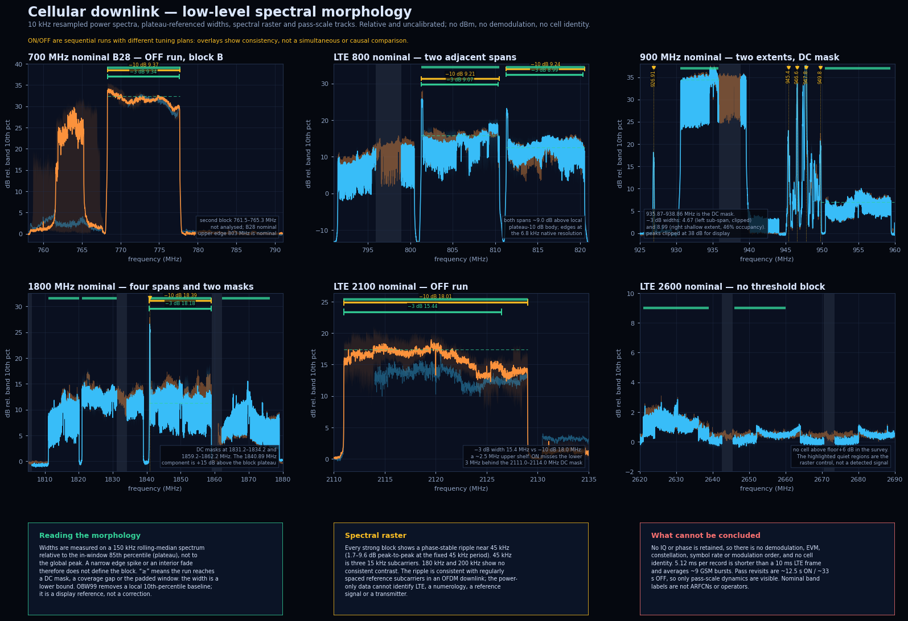
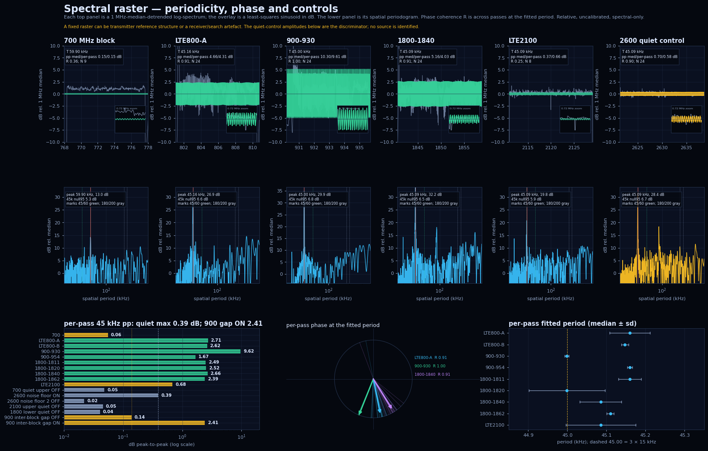
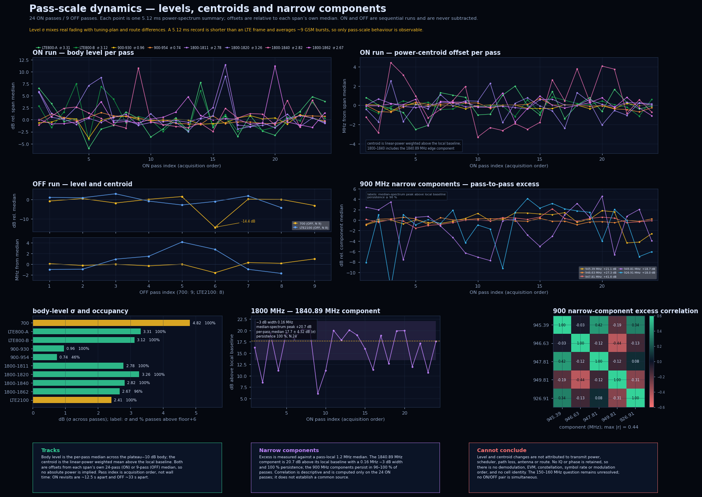

# Cellular downlink: low-level modulation morphology

Relative, uncalibrated spectral analysis of the `fullrange-20261118-111658` captures. The input was an antenna on RX2; ON and OFF are sequential 300 s windows, not simultaneous measurements. All levels are relative. No dBm, noise figure, absolute floor or traceability is claimed.

Band and channel names are **nominal allocations** (LTE B20/B8/B3/B1/B7/B28; GSM 900/1800 downlink). No decoding, cell identity, ARFCN or operator attribution is attempted. The analysis is spectral-only: no IQ or phase was retained, so nothing here is a demodulation.







**Figure guide.** Figure 1 shows the six morphology panels with the other run overlaid as a thin line and the measured −3/−10 dB brackets where the span permits (the 900 MHz panel uses a text note because its left extent is DC-mask clipped). Figure 2 shows the detrended median spectrum, its 0.72 MHz zoom and the spatial periodogram for five blocks plus a quiet control, then the 45 kHz amplitudes against quiet controls, the per-pass phase vectors and the per-pass fitted period. Figure 3 shows the ON and OFF pass-scale tracks, the level σ/occupancy summary, the 900 MHz narrow-component series and correlation matrix, and the 1840.89 MHz component. Every figure is relative and uncalibrated.

## Scope and data

| | |
| --- | --- |
| Session | `fullrange-20261118-111658` |
| Device | B200mini `30B2A32`, antenna `RX2`, 20 dB |
| Captures | 5,125 ON records / 7,061 OFF records; 24 ON / 9 OFF pass groups |
| Raw record | 8,192 FFT bins, Hann window, `bin_width_hz = 6835.9375`, `window_enbw_hz = 10253.906`, 286,720 samples = 5.12 ms at 56 MS/s |
| Fine grid | 10 kHz, linear-power interpolation from the native bins (`linear_power_interp`) |
| Masks | 8 MHz capture edge; ±1.5 MHz DC; cells with < 50 % pass coverage |
| Deep dive | LTE 800, 900 MHz, 1800 MHz, LTE 2100, LTE 2600; 700 MHz B28 as a sixth morphology panel |

The fine cache does not add information: it resamples the same 8192-bin power spectra onto a 10 kHz grid. It removes the 60 kHz resampling beat that nearest-bin assignment produced and makes the 45 kHz raster and the narrow-component widths legible. The 150 kHz rolling median used for morphology is a measurement smoother, not a correction; no notch, exclusion or level correction is applied.

A 5.12 ms record is shorter than a 10 ms LTE frame and averages about nine GSM bursts. Pass revisits are about 12.5 s ON and 33 s OFF. The analysis therefore resolves pass-scale behaviour, not frame, slot or burst structure.

## Method

**Fine spectrum.** Each band is extracted from the per-pass power matrices, interpolated in linear power to 10 kHz, masked at the capture edge (±8 MHz), the DC gap (±1.5 MHz around the tuned centre) and cells with < 50 % pass coverage. The reported spectrum is the median across passes in each run. ON and OFF are never subtracted and no common reference is imposed.

**Morphology.** A 150 kHz rolling median gives the block shape. The plateau is the 85th percentile of that smoothed spectrum inside the analysis window. Widths are the outermost crossings of the plateau at −3, −10 and −20 dB inside the plateau−10 dB support, so a narrow edge spike or an interior fade cannot collapse the width to one run. A side that reaches a DC mask, a coverage gap or the padded window is marked `≥`: the width is a lower bound. OBW99 is the 99 % power interval of the same body after removing a local 10th-percentile baseline; it is a display reference, not a correction. Ripple is the IQR of the smoothed body; p95−p5 is its 5–95 % range; flatness is the geometric-to-arithmetic mean ratio of baseline-subtracted linear power. Shoulders are the 3→20 dB transition widths outside the −3 dB crossings. Troughs are runs at least 6 dB below the plateau and at least 0.12 MHz wide.

**Raster.** The median spectrum is detrended by a 1 MHz rolling median. A spatial periodogram over 25–400 kHz is computed with a Tukey window; `null95` is the 95th percentile of 60 permutation spectra with the same sample positions. A fixed-period sinusoid is then fitted to every pass at 45 kHz and at the periodogram maximum. `R` is the phase coherence of those per-pass fits, `pp` their mean peak-to-peak amplitude in dB, and the per-pass period is the periodogram maximum within ±15 % of the tested period. `R` and contrast are not amplitude: a tiny quiet-control ripple can be coherent and can have high relative contrast.

**Dynamics.** Per pass, the body level is the median across the plateau−10 dB body; the power centroid is the linear-power weighted mean frequency above the local baseline. Level σ is the standard deviation of the body level across passes; occupancy is the fraction of passes whose body level exceeds the band floor +6 dB. These are descriptive pass statistics, not measurement uncertainties and not transmit powers.

**Narrow components.** For each listed frequency, the local baseline is the median of the median spectrum in a 1.2 MHz window excluding ±0.15 MHz around the peak. The peak, its −3/−10/−20 dB widths and the per-pass excess at the peak bin are reported. Persistence is the fraction of ON passes with excess > 6 dB. Correlations are computed on the 24 ON passes only and are descriptive; no multiple-comparison correction is applied.

## Morphology summary

| Block | Run | Window (MHz) | plateau−floor (dB) | peak exc. (dB) | OBW99 (MHz) | −3 dB (MHz) | −10 dB (MHz) | −20 dB (MHz) | Reliable |
| --- | --- | ---: | ---: | ---: | ---: | ---: | ---: | ---: | :---: |
| 700 | OFF | 768.25–777.75 | 32.4 | +1.7 | 9.25 | 9.34 | 9.37 | 9.37 | yes |
| LTE800-A | ON | 801.30–810.50 | 15.8 | +10.0 | 9.06 | 9.07 | 9.21 | 9.21 | yes |
| LTE800-B | ON | 811.30–820.50 | 12.6 | +10.6 | 8.98 | 8.99 | 9.24 | 9.24 | yes |
| 900-930 | ON | 930.55–935.80 | 34.4 | +2.8 | 5.05 | 4.67 | ≥5.22 | ≥5.22 | no |
| 900-954 | ON | 950.40–959.45 | 7.0 | +3.0 | 8.89 | 8.99 | ≥10.04 | ≥10.04 | no |
| 1800-1811 | ON | 1811.05–1820.15 | 10.2 | +3.6 | 8.83 | 7.93 | 9.05 | 9.05 | yes |
| 1800-1820 | ON | 1820.95–1831.15 | 12.8 | +2.5 | 10.10 | ≥10.20 | ≥10.21 | ≥10.21 | no |
| 1800-1840 | ON | 1840.75–1859.05 | 11.3 | +15.3 | 17.86 | 18.18 | 18.39 | 18.39 | yes |
| 1800-1862 | ON | 1862.22–1876.20 | 8.8 | +6.7 | 12.48 | 13.56 | ≥14.51 | ≥14.51 | no |
| LTE2100 | OFF | 2110.95–2129.05 | 17.4 | +1.6 | 17.44 | 15.44 | 18.01 | 18.01 | yes |

`plateau−floor` is the smoothed plateau minus the band 10th-percentile floor. `peak exc.` is a single-cell maximum above the plateau, often an edge spike or a narrow component; it is not the body level. `Reliable = no` means a width reaches a mask, a coverage gap or the padded window, or the block is threshold-limited; the width is then a lower bound or a threshold extent, not a channel bandwidth.

| Block | Ripple IQR (dB) | p95−p5 (dB) | Flatness | Shoulders L/R (MHz) | Troughs |
| --- | ---: | ---: | ---: | ---: | --- |
| 700 | 0.90 | 3.81 | 0.971 | 0.08/0.06 | — |
| LTE800-A | 4.15 | 8.21 | 0.559 | 0.12/0.18 | — |
| LTE800-B | 1.53 | 4.12 | 0.739 | 0.15/0.29 | — |
| 900-930 | 3.22 | 7.72 | 0.789 | 0.52/— | — |
| 900-954 | 1.71 | 7.53 | 0.938 | —/— | 959.52–959.95 (7.3 dB); 949.92–950.49 (7.1 dB) |
| 1800-1811 | 1.43 | 5.63 | 0.885 | —/— | — |
| 1800-1820 | 0.84 | 2.48 | 0.786 | —/— | — |
| 1800-1840 | 1.59 | 5.20 | 0.407 | —/— | — |
| 1800-1862 | 2.02 | 6.28 | 0.470 | —/— | — |
| LTE2100 | 2.47 | 4.39 | 0.649 | —/— | — |

### Per-block notes

**700 MHz nominal B28 (OFF, block B).** The analysed block is 768.25–777.75 MHz. Its plateau is 32.4 dB above the band floor, the −3 dB width is 9.34 MHz and the −10 dB width 9.37 MHz: the shape is close to rectangular (flatness 0.971, ripple 0.90 dB, shoulders 0.08/0.06 MHz). It does **not** carry the 45 kHz raster: the fixed 45 kHz fit is 0.06 dB peak-to-peak with R 0.22, and the periodogram maximum is 59.90 kHz at only 0.15 dB with R 0.36; its 13.0 dB relative contrast comes from a 0.15 dB ripple, not from the 45 kHz raster. The block is OFF-variant; the ON plan masks part of it. A second OFF block at 761.5–765.3 MHz is visible but not analysed. The 803 MHz upper edge of B28 is nominal; the analysis stops at 791 MHz to avoid duplicating LTE 800.

**LTE 800 nominal (ON).** Two adjacent spans: A 801.30–810.50 MHz and B 811.30–820.50 MHz. A: −3 dB 9.07 MHz, −10 dB 9.21 MHz, OBW99 9.06 MHz, plateau−floor 15.8 dB. B: −3 dB 8.99 MHz, −10 dB 9.24 MHz, OBW99 8.98 MHz, plateau−floor 12.6 dB. Both are about 9 MHz wide on the fine grid, consistent with a nominal 9 MHz LTE channel, but the measurement does not identify a channel or a numerology. The peak excursions (+10.0 and +10.6 dB) are single-cell edge spikes; the body ripple is 4.15 and 1.53 dB. Both spans carry the 45 kHz raster (2.71 and 2.62 dB per-pass pp at the fixed period; peak-period R 0.91 and 0.99).

**900 MHz nominal (ON).** Left span 930.55–935.80 MHz: −3 dB 4.67 MHz, −10 dB ≥5.22 MHz, OBW99 5.05 MHz, plateau−floor 34.4 dB. The −10 dB run reaches the DC mask at 935.87–938.86 MHz, so 5.22 MHz is a lower bound, not a channel width; the block is detected across the mask in the survey. Right span 950.40–959.45 MHz: −3 dB 8.99 MHz, −10 dB ≥10.04 MHz, plateau−floor 7.0 dB, occupancy only 46 %. This is a threshold extent, not an established 9 MHz channel; troughs at 949.92–950.49 and 959.52–959.95 MHz are about 7 dB deep. The left span has the strongest raster: 9.61 dB pp, contrast 29.9 dB, R 1.00, period 45.00±0.01 kHz.

**1800 MHz nominal (ON).** Four spans. 1811: −3 dB 7.93, −10 dB 9.05 MHz, plateau−floor 10.2 dB. 1820: −3 dB ≥10.20, −10 dB ≥10.21 MHz, plateau−floor 12.8 dB; the span fills the window, so these are lower bounds. 1840: −3 dB 18.18, −10 dB 18.39 MHz, plateau−floor 11.3 dB; the 1840.89 MHz narrow component sits at its left edge. 1862: −3 dB 13.56, −10 dB ≥14.51 MHz, plateau−floor 8.8 dB; this weak tail is threshold-limited and its occupancy is 96 %. All four carry a 45 kHz raster between 2.39 and 2.66 dB pp at the fixed period, with peak-period R 0.74–0.92. The ~1831–1834 and 1859–1862 MHz breaks coincide with ON DC masks; they are measurement gaps, not emission gaps.

**LTE 2100 nominal (OFF).** One span 2110.95–2129.05 MHz: −3 dB 15.44 MHz, −10 dB 18.01 MHz, OBW99 17.44 MHz, plateau−floor 17.4 dB. The −3 dB width is 2.57 MHz narrower than −10 dB: a broad upper shelf rather than a rectangular channel. The ON plan misses the lower ~3 MHz behind the 2111.01–2113.99 MHz DC mask. The 45 kHz raster is weak and pass-variable: 0.68 dB pp, R 0.40 (fixed 45 kHz; peak-period R 0.25), period 45.09±0.09 kHz, N 8.

**LTE 2600 nominal.** No cell reaches floor +6 dB in either run. The ON per-pass peak median is +2.4 dB above the 10th-percentile floor and OFF +2.3 dB (survey). No wideband or narrow block is claimed. The two highlighted regions (2621–2639 MHz ON and 2642–2660 MHz OFF) are quiet controls, not detections. Absence of a threshold crossing is not proof that no signal exists below it.

## Spectral raster

| Block | 45 kHz pp (dB) | peak T (kHz) | peak pp (dB) | peak contrast (dB) | 45k null95 (dB) | 180k contrast (dB) | 200k contrast (dB) | R (peak) | per-pass T (kHz) | N |
| --- | ---: | ---: | ---: | ---: | ---: | ---: | ---: | ---: | ---: | ---: |
| 700 | 0.06 | 59.90 | 0.15 | 13.0 | 5.3 | 4.5 | 5.5 | 0.36 | 60.01±3.10 | 9 |
| LTE800-A | 2.71 | 45.16 | 4.31 | 26.9 | 6.6 | -6.5 | -2.4 | 0.91 | 45.16±0.05 | 24 |
| LTE800-B | 2.62 | 45.15 | 4.28 | 29.0 | 6.7 | 2.0 | -2.0 | 0.99 | 45.15±0.01 | 24 |
| 900-930 | 9.62 | 45.00 | 9.61 | 29.9 | 6.8 | -1.3 | 2.0 | 1.00 | 45.00±0.01 | 24 |
| 900-954 | 1.67 | 45.16 | 2.68 | 26.7 | 6.3 | -8.0 | -1.1 | 1.00 | 45.16±0.01 | 24 |
| 1800-1811 | 2.49 | 45.16 | 4.16 | 27.6 | 6.0 | -6.9 | -4.7 | 0.92 | 45.16±0.03 | 24 |
| 1800-1820 | 2.52 | 45.00 | 2.52 | 32.6 | 6.4 | -5.4 | 3.4 | 0.74 | 45.00±0.10 | 24 |
| 1800-1840 | 2.66 | 45.09 | 4.03 | 32.2 | 6.5 | 3.9 | -6.0 | 0.91 | 45.09±0.05 | 24 |
| 1800-1862 | 2.39 | 45.11 | 3.71 | 28.9 | 6.4 | 2.6 | -1.0 | 0.91 | 45.11±0.01 | 24 |
| LTE2100 | 0.68 | 45.09 | 0.66 | 19.8 | 5.9 | 0.2 | -4.8 | 0.25 | 45.09±0.09 | 8 |

The 45 kHz amplitude is the fixed-period per-pass fit; `peak T` and `peak pp` are the periodogram maximum. `null95` is the permutation 95th percentile at 45 kHz; `contrast` is the periodogram peak relative to its median. Periods cluster at 45.00–45.16 kHz. 45 kHz is exactly 3 × 15 kHz. This is **consistent with** a 3-subcarrier comb such as reference-signal placement in an OFDM downlink, but it is not an identification: a receiver/search artifact or an intermodulation product could also be periodic.

| Control | Run | Span (MHz) | 45 kHz pp (dB) | 45k contrast (dB) | R (45k) | peak T (kHz) | peak pp (dB) |
| --- | --- | ---: | ---: | ---: | ---: | ---: | ---: |
| 700 quiet upper | OFF | 780.00–790.00 | 0.05 | 8.8 | 0.83 | 45.13 | 0.07 |
| 2600 noise floor | ON | 2621.00–2639.00 | 0.39 | 24.2 | 0.77 | 45.09 | 0.58 |
| 2600 noise floor 2 | OFF | 2642.00–2660.00 | 0.02 | -14.1 | 0.26 | 52.98 | 0.02 |
| 2100 upper quiet | OFF | 2130.00–2169.00 | 0.05 | 4.5 | 0.47 | 180.19 | 0.36 |
| 1800 lower quiet | OFF | 1806.30–1811.00 | 0.04 | -2.7 | 0.45 | 60.64 | 0.07 |
| 900 inter-block gap | OFF | 940.50–945.00 | 0.14 | 17.8 | 0.97 | 45.18 | 0.15 |
| 900 inter-block gap | ON | 940.50–945.00 | 2.41 | 32.0 | 0.92 | 44.99 | 2.41 |

The quiet controls span 0.02–0.39 dB pp at 45 kHz. The strong blocks span 1.67–9.62 dB pp at the fixed 45 kHz period (2.68–9.61 dB at the peak period), about 4–25× the quiet maximum. The 700 MHz block (0.06 dB) is at the quiet level; LTE 2100 (0.68 dB) is above it but far below the strong blocks and has R 0.25 with only eight OFF passes. The 900 inter-block gap in ON shows 2.41 dB pp at 45 kHz (OFF 0.14 dB): well above the quiet controls and at the low end of the block amplitudes, comparable to the 1800 spans, but the gap is not a detected block. Its cause is unresolved and it is not attributed to a transmitter or to the feature bundle.

Two cautions follow from the controls. First, phase coherence alone is not amplitude: the 700 quiet control has R 0.83 at 0.05 dB pp, and the 2600 ON control has 0.39 dB pp but 24.2 dB relative contrast. Second, 180 kHz and 200 kHz show no consistent contrast across the strong blocks (180 kHz −8.0 to +4.5 dB; 200 kHz −6.0 to +5.5 dB), so there is no spectral evidence here for a 180 kHz PRB comb or a 200 kHz GSM burst raster at these spans.

## ON/OFF overlays and extents

Figure 1 overlays the other run’s median at the same within-band reference. The overlay is a display aid, not a subtraction, and no difference is computed from it. Where a level delta is quoted elsewhere in this results set, the valid quantity is the matched common-span median from `CELLULAR.md`: the intersection of the two threshold extents. Own-span medians are not like-for-like when the extents differ. That applies to the 900 MHz 954 MHz span (ON starts higher) and the 1800 MHz 1862 MHz span (OFF extends further on both sides). The 700 MHz and LTE 2100 morphology panels are OFF-variant; their ON overlays are shown for context only. The 1831–1834 and 1859–1862 MHz breaks coincide with ON DC masks and are measurement gaps, not emission gaps.

## Pass-scale dynamics

| Block | Run | Centroid (MHz) | Centroid σ (MHz) | Level σ (dB) | Occupancy | Level range (dB) | N |
| --- | --- | ---: | ---: | ---: | ---: | ---: | ---: |
| 700 | OFF | 772.36 | 0.69 | 4.82 | 100 % | -14.35 … +1.47 | 9 |
| LTE800-A | ON | 805.22 | 1.17 | 3.31 | 100 % | -5.98 … +7.76 | 24 |
| LTE800-B | ON | 815.32 | 0.54 | 3.12 | 100 % | -4.20 … +7.51 | 24 |
| 900-930 | ON | 933.86 | 0.20 | 0.96 | 100 % | -3.87 … +1.04 | 24 |
| 900-954 | ON | 955.48 | 0.34 | 0.74 | 46 % | -1.01 … +1.47 | 24 |
| 1800-1811 | ON | 1816.08 | 0.30 | 2.78 | 100 % | -1.67 … +11.48 | 24 |
| 1800-1820 | ON | 1825.90 | 1.26 | 3.26 | 100 % | -2.42 … +9.05 | 24 |
| 1800-1840 | ON | 1847.77 | 2.43 | 2.82 | 100 % | -2.45 … +10.79 | 24 |
| 1800-1862 | ON | 1869.04 | 0.78 | 2.67 | 96 % | -1.60 … +11.15 | 24 |
| LTE2100 | OFF | 2117.85 | 2.10 | 2.41 | 100 % | -4.24 … +2.89 | 8 |

Level σ is the pass-to-pass standard deviation of the body median, not an uncertainty. It includes real fading, tuning-plan and route differences. The 900 MHz spans are the most stable (σ 0.74–0.96 dB); the 700 MHz OFF block has σ 4.82 dB and one pass 14.35 dB below its median; the 1800 MHz spans reach single-pass positive excursions of +9.0 to +11.5 dB. None of these is attributed to transmit power, scheduler, path loss or antenna.

The power centroid is biased by strong narrow components. In 1800–1840 the 1840.89 MHz component sits at the left edge and the centroid wanders 2.43 MHz (σ), so that value is not body motion alone. The 900–930 centroid is stable at 0.20 MHz. LTE 2100 has a 2.10 MHz centroid σ over only eight OFF passes. ON/OFF tracks are separate sequential runs and are not subtracted.

## Narrow components

| Run | MHz | Peak MHz | Above local baseline (dB) | −3 dB (MHz) | −10 dB (MHz) | Persistence | Excess σ (dB) | N |
| --- | ---: | ---: | ---: | ---: | ---: | ---: | ---: | ---: |
| gsm900 | 945.39 | 945.40 | +21.1 | 0.07 | 0.17 | 100 % | 1.63 | 24 |
| gsm900 | 946.63 | 946.63 | +27.3 | 0.06 | 0.16 | 100 % | 0.40 | 24 |
| gsm900 | 947.81 | 947.80 | +41.6 | 0.09 | 0.17 | 100 % | 0.69 | 24 |
| gsm900 | 949.81 | 949.82 | +18.7 | 0.09 | 0.17 | 100 % | 3.82 | 24 |
| gsm900 | 926.91 | 926.88 | +18.0 | 0.09 | 0.17 | 96 % | 4.43 | 24 |
| mhz1800 | 1840.89 | 1840.89 | +20.7 | 0.16 | 0.18 | 100 % | 4.32 | 24 |

`Above local baseline` is the peak of the median spectrum over a 1.2 MHz local baseline; `excess σ` is the standard deviation of the per-pass excess at the peak bin. The −3 dB widths (0.06–0.16 MHz) are measured on the 10 kHz fine grid; they differ from the 20/50 kHz survey values by up to one grid cell and are not modulation bandwidths.

The 900 MHz components are narrow and persistent: 947.81 MHz is the strongest (+41.6 dB above its local baseline), while 949.81 and 926.91 MHz have larger excess σ (3.82 and 4.43 dB) than the stable trio (0.40–1.63 dB). 926.91 MHz persists in 96 % of ON passes, not 100 %. The 1840.89 MHz component is +20.7 dB above its local baseline with a 0.16 MHz −3 dB width in the median spectrum; its per-pass median is 17.7 dB with σ 4.32 dB. These are spectral shapes only: a narrow component could be a CW carrier, an intermodulation product, a receiver spur or a narrowband emission. No identity is claimed.

Correlation of the 900 MHz per-pass excess (24 ON passes):

| | 945.39 | 946.63 | 947.81 | 949.81 | 926.91 |
| --- | ---: | ---: | ---: | ---: | ---: |
| 945.39 | 1.00 | -0.03 | 0.42 | -0.19 | 0.34 |
| 946.63 | -0.03 | 1.00 | -0.12 | -0.44 | -0.13 |
| 947.81 | 0.42 | -0.12 | 1.00 | -0.12 | 0.08 |
| 949.81 | -0.19 | -0.44 | -0.12 | 1.00 | -0.31 |
| 926.91 | 0.34 | -0.13 | 0.08 | -0.31 | 1.00 |

The largest |r| is 0.44 (946.63 vs 949.81); 945.39 vs 947.81 is 0.42. With 24 passes and no multiple-comparison correction these are weak descriptive associations, not evidence of a common modulation or a common source. No strong common pass-scale modulation is present.

## Candidate interpretations

| Observation | Consistent with | Not established / caveat |
| --- | --- | --- |
| 45 kHz comb, period 45.00–45.16 kHz, peak-period R 0.74–1.00, 1.7–9.6 dB pp at fixed 45 kHz | a 3 × 15 kHz reference-subcarrier comb in an OFDM downlink | receiver/search artifact or intermodulation; no phase, no demodulation; source not identified |
| ~9 MHz LTE 800 spans and ~18 MHz 1800/2100 extents | wideband downlink emissions | widths are plateau/threshold measurements, not channel bandwidths; no standard or operator identified |
| LTE 2100 −3 dB 15.44 MHz vs −10 dB 18.01 MHz | a broad upper shelf from the transmit envelope or receive filter | no transmitter or filter identification; OFF only; ON misses the lower edge behind DC |
| 700 MHz OFF block: 9.34 MHz, flatness 0.971, no 45 kHz raster | a different signal type or a different OFF-plan/receiver state | sequential OFF data; the ON plan masks part of the block; not attributed |
| 900 MHz narrow components, 0.06–0.09 MHz −3 dB, 96–100 % persistence | CW, intermodulation, receiver spurs or narrowband emissions | below a 180 kHz PRB and a 200 kHz GSM channel; no identity or ARFCN |
| 1840.89 MHz component, 0.16 MHz −3 dB, +20.7 dB above local baseline | a narrow carrier or an aggregation artifact | biases the 1800–1840 power centroid; no identity |
| 900 inter-block gap ON, 2.41 dB pp at 45 kHz | weak or intermediate raster in the gap | not a detected block; cause unresolved; OFF shows 0.14 dB |

## What the evidence is consistent with

- The ~45 kHz raster is **consistent with** a 3 × 15 kHz spectral comb, such as reference-signal placement in an OFDM downlink. It is present in every strong block (LTE 800 A/B, 900-930, 900-954, all four 1800 spans) with periods 45.00–45.16 kHz, phase R 0.74–1.00 and amplitudes 1.7–9.6 dB pp at the fixed 45 kHz period (2.7–9.6 dB pp at the peak period), and is absent or weak in the 700 MHz OFF block, LTE 2100 and all quiet controls. The data cannot distinguish reference signals from a receiver/search artifact or an intermodulation product.
- The ~9 MHz LTE 800 spans, the ~18 MHz 1800–1840 span and the ~18 MHz LTE 2100 −10 dB span are **consistent with** wideband downlink emissions. The widths are threshold/plateau measurements, not channel bandwidths, and no demodulation is performed.
- The LTE 2100 −3 dB width (15.44 MHz) is 2.57 MHz narrower than −10 dB (18.01 MHz), a broad upper shelf. This is **consistent with** a wider transmitted envelope or a filter shape, but no transmitter or standard is identified.
- The 700 MHz OFF block is flat and nearly rectangular and lacks the 45 kHz raster. That is **consistent with** a different signal type or a different OFF-plan/receiver state; because the runs are sequential and the plans differ, it is not attributed to a technology or an operator.
- The 900 MHz narrow components and the 1840.89 MHz component are **consistent with** narrow spectral features, but their widths are below a 180 kHz PRB and a 200 kHz GSM channel. They could be CW, intermodulation, receiver spurs or narrowband emissions; no identity is claimed.

## What cannot be concluded

- **No demodulation.** Raw JSONL stores 8192-bin FFT power only; the rejected IQ directory has an empty record list. There is no phase, so no EVM, constellation, symbol rate, modulation order, cell identity, ARFCN or operator attribution is possible.
- **No absolute level.** All values are relative and uncalibrated. No dBm, EIRP, path loss, noise figure, absolute floor or traceability is claimed. `plateau−floor` and peak excess are differences, not powers.
- **No causal ON/OFF difference.** ON and OFF are sequential 300 s windows with different tuning plans. Overlays show consistency, not a simultaneous comparison; differences include RF-environment change.
- **No frame or burst resolution.** A 5.12 ms record is shorter than a 10 ms LTE frame and averages about nine GSM bursts. Only pass-scale dynamics are observable.
- **No per-feature ablation.** The ON/OFF plans differ, so a feature cannot be switched in isolation. The 900 inter-block gap ON excess (2.41 dB pp at 45 kHz) is intermediate and unresolved.
- **No proof of absence.** LTE 2600 and several survey windows have no threshold crossing. That is not proof that no signal exists below the threshold. Widths that reach a mask, a coverage gap or the padded window are lower bounds (`≥`), not completed edges.
- **No raster source.** A fixed 45 kHz raster can be transmitter reference structure or a receiver/search artifact. The quiet controls constrain its amplitude but do not identify its origin.

## 150–160 MHz

The session’s 150–160 MHz behaviour remains unresolved: the ON per-pass median range is 18.78 dB while OFF sits near its floor. It is outside the cellular bands, is not used here, and is not notched, excluded or corrected. Resolving it requires a controlled 50 Ω input and/or an alternating ON/OFF source.

## Reproduce

```sh
env -u PYTHONPATH sessions/.venv/bin/python tools/report_modulation.py \
    sessions/fullrange-20261118-111658 --use-cache \
    --out docs/results/fullrange-20261118-111658/cellular_modulation.png \
    --raster-out docs/results/fullrange-20261118-111658/cellular_modulation_raster.png \
    --dyn-out docs/results/fullrange-20261118-111658/cellular_modulation_dynamics.png \
    --md docs/results/fullrange-20261118-111658/MODULATION.md
```

The fine cache is `sessions/fullrange-20261118-111658/report/modulation_cache.npz` (10 kHz, linear power interpolation, 5125 ON / 7061 OFF records). Raw JSONL stays in `sessions/` and is not committed.

