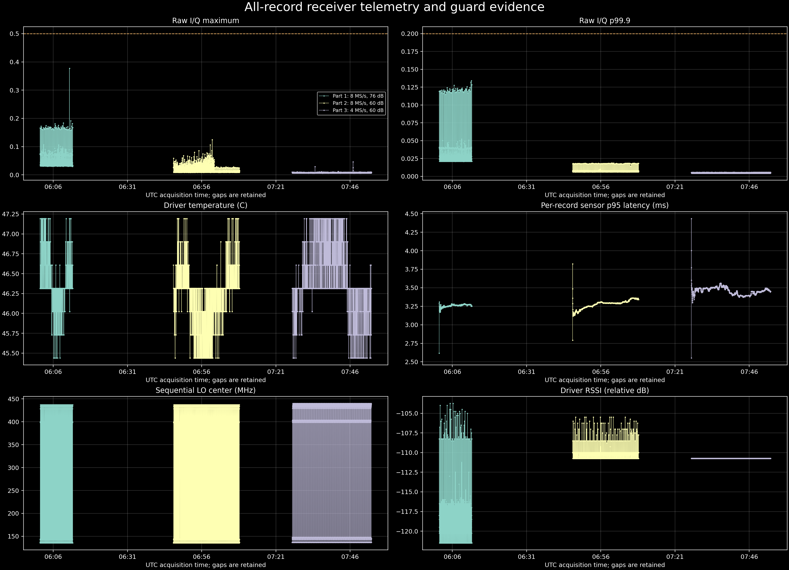
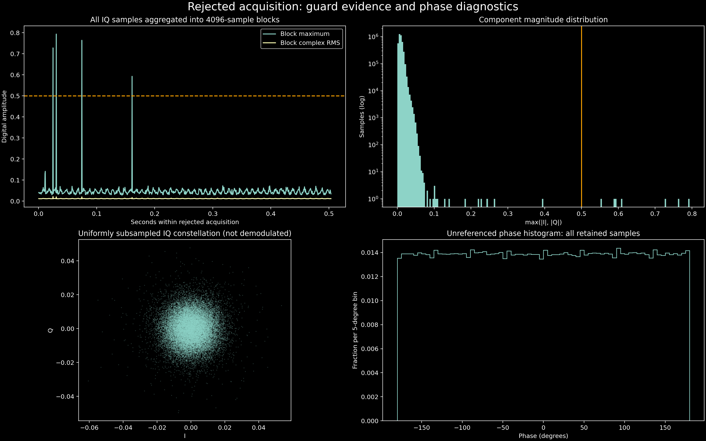

# Full hour scan analysis: 23 November 2026

[42-page full analysis](full-analysis.pdf) · [complete analysis JSON](summary.json) · [every-record telemetry CSV](telemetry.csv) · [validation](validation.txt)

All **5,163 accepted records** and **130,318,336 recorded spectral-bin positions** were processed, with masked/untrusted bins retained as missing. The three gain/rate contexts remain separate. Credited sequential scan span totals **3600.983 s**; summed host-record RF dwell is **2604.457 s**. Normal retune gaps are part of scan span, not RF dwell; setup and interruptions are excluded.

| Part | MS/s | Gain dB | Records | Complete / partial sweeps | Credited scan s | RF dwell s |
|---|---:|---:|---:|---:|---:|---:|
| 1 | 8 | 76 | 925 | 66 / 1 | 661.641 | 466.141 |
| 2 | 8 | 60 | 1866 | 133 / 1 | 1335.974 | 940.478 |
| 3 | 4 | 60 | 2372 | 91 / 1 | 1603.367 | 1197.839 |

## Findings

- No Doppler-like tracks, drifting tracks or decoded satellite identities were established. The pass lists describe predictions, not receptions.
- Part 1 has 65 persistent lines, 40 events and 47 wideband transients; part 2 has 34 lines, 61 events and no wideband transients; part 3 has 29 lines, 31 events and no wideband transients. These are per-part detections, not unique transmitter counts. Different time, gain and bandwidth prevent a calibrated causal ON/OFF comparison.
- All accepted records passed headroom, RF-state validity, fresh-temperature, RX LO-lock and native-chain checks. Internal clock operation does not require an external reference lock.
- The first run stopped at a conservative headroom guard: 7 of 4,030,464 retained IQ samples crossed 0.5 full scale; none reached 0.95. Peak 0.7934 does not itself demonstrate ADC rail clipping or identify the origin of the peaks.
- The second run's last accepted record at 08:09:25 Oslo aligns with idle sleep at 08:09:24. Wake at 08:18:30 was followed by an uncaught UHD USBError -4 / LIBUSB_ERROR_NO_DEVICE abort. Sleep/wake is the strongest identified trigger; bandwidth overload or a faulty cable was not proven. [Power-log excerpt](sleep-wake.log).
- The 4 MS/s / 60 dB retry completed with temporary sleep prevention. All three sessions together exceed the requested hour by about one second.

## Corrections

The runner now holds scan-scoped sleep assertions, delegates to a supervisor with bounded transport recovery and a stall watchdog, preserves every raw attempt, credits only qualified recording intervals, and backs off gain only after verifying retained rejected-IQ hashes. Gain changes produce separate reports. Unknown native crashes remain fatal, and incomplete reports are not published over an older bundle.

Automatic gain selection reserves 12 dB on both peak and p99.9 amplitude. [Replay of the original pilot](gain-policy-replay.json) selects **60 dB**, rather than 76 dB. This is an engineering reserve, not a guarantee of future burst levels or verified analog linearity. Complete and partial sweeps are counted separately; identification tables paginate by wrapped row height.

616 passed, 1 skipped, 137 warnings, 112 subtests passed in 139.51s (0:02:19). Final shell checks: 4 passed. [Hardware supervisor validation](hardware-validation.json): 31 guarded records, sleep assertions verified. Native abort/reconnect, cancellation, file stalls, gain backoff and evidence failures were fault-injected without physical device removal or forced sleep.

## Visuals and complete inventories





- Part 1: [uhf_399_9_403_mhz](part-01/superscan_waterfall_uhf_399_9_403_mhz.html), [uhf_430_440_mhz](part-01/superscan_waterfall_uhf_430_440_mhz.html), [vhf_137_138_mhz](part-01/superscan_waterfall_vhf_137_138_mhz.html), [vhf_144_146_mhz](part-01/superscan_waterfall_vhf_144_146_mhz.html)
- Part 2: [uhf_399_9_403_mhz](part-02/superscan_waterfall_uhf_399_9_403_mhz.html), [uhf_430_440_mhz](part-02/superscan_waterfall_uhf_430_440_mhz.html), [vhf_137_138_mhz](part-02/superscan_waterfall_vhf_137_138_mhz.html), [vhf_144_146_mhz](part-02/superscan_waterfall_vhf_144_146_mhz.html)
- Part 3: [uhf_399_9_403_mhz](part-03/superscan_waterfall_uhf_399_9_403_mhz.html), [uhf_430_440_mhz](part-03/superscan_waterfall_uhf_430_440_mhz.html), [vhf_137_138_mhz](part-03/superscan_waterfall_vhf_137_138_mhz.html), [vhf_144_146_mhz](part-03/superscan_waterfall_vhf_144_146_mhz.html)

Each `part-NN` directory also contains tracks, persistent-line, event and predicted-pass CSVs plus a complete summary JSON. Interactive waterfalls use native quantized display grids and retain actual acquisition time support; missing cells are not measurements. The combined PDF includes every partition's plot and paginated signal table.

## Reproduction and limits

```sh
python -m pip install numpy scipy matplotlib sgp4 pypdf reportlab
python tools/analyze_scan_set.py OUTPUT SESSION_1 SESSION_2 SESSION_3
```

Raw JSONL and IQ remain in local acquisition sessions and are not committed here. Source digests are in the analysis JSON. Local path prefixes have been removed from the public JSON export. The SHA-256 of the private observer-position file (`qth.json`) is withheld in the reference provenance (redacted 2026-11-24; `sha256.json` updated for the four affected summaries and this file). Do not concatenate the raw contexts into one homogeneous file.

Antenna measurements do not establish absolute power, noise figure, analog compression or calibrated sensitivity. PSD cannot recover waveform phase; phase diagnostics use only the retained rejected IQ, without a coherent reference. LO-origin labels remain diagnostic hypotheses, and off-curve controls do not provide a calibrated global false-discovery probability.

Satellite/transmitter references use [SatNOGS DB](https://db.satnogs.org/) (CC BY-SA), with cached TLE-source provenance retained in the local frozen reference bundles. Predictions remain reference-dependent.
